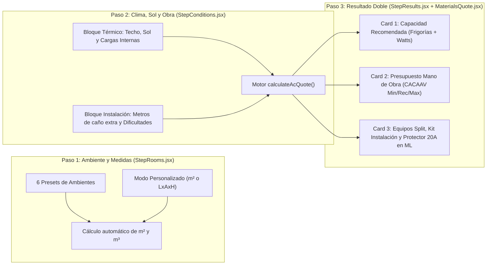
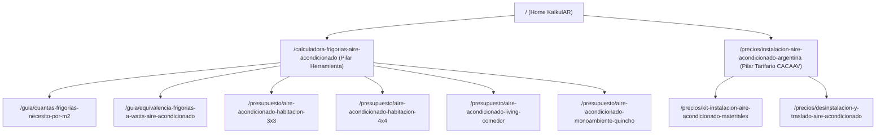

# ❄️ Investigación de Ingeniería Termomecánica, Costos de Obra y Especificación Técnica pSEO — Módulo Climatización KalkulAR (Temporada 2026/2027)

**Proyecto:** KalkulAR (`https://kalkular.com`)  
**Rol Técnico:** Ingeniero Termomecánico Matriculado (CACAAV), Analista de Costos de Obra y Estratega de Programmatic SEO  
**Alcance:** Relevamiento de mercado en Argentina (Primavera-Verano 2026/2027), algoritmo de balance térmico residencial/comercial, tarifario de mano de obra de instalación de Aires Acondicionados Split, catálogo de afiliados de Mercado Libre Argentina (`MLA`) y arquitectura de datos para el Agente Desarrollador (Fase 2).

---

## 1. Fórmulas Matemáticas Exactas de Cálculo de Frigorías (Normativa Argentina)

En la práctica termomecánica argentina (basada en los lineamientos de balance térmico simplificado de la **Cámara Argentina de Calefacción, Aire Acondicionado y Ventilación — CACAAV** y zonificación bioambiental **IRAM 11603**), el dimensionamiento de equipos Split residenciales y comerciales ligeros debe partir siempre del **volumen real del local ($m^3$)** y no únicamente de la superficie en planta ($m^2$), aplicando luego factores de corrección por carga solar, transmitancia térmica de cerramientos superiores (techo) y ganancias internas (calor sensible y latente por ocupantes y equipamiento).

### 1.1. Fórmula Base Volumétrica ($m^3$)

$$\text{Volumen } (V) = \text{Largo } (L) \times \text{Ancho } (W) \times \text{Alto } (H) \quad [m^3]$$

*(Si el usuario ingresa directamente los metros cuadrados de planta $S_{m^2}$ en modo manual sin especificar dimensiones de largo y ancho, se adopta la altura estándar de edificación en Argentina $H = 2.50\text{ m}$, resultando $V = S_{m^2} \times 2.50\text{ m}^3$, o bien $S_{m^2} \times H$ si modifica la altura).*

#### Coeficiente Base Volumétrico en Argentina ($C_{\text{base}}$):
- **Estándar Nacional (Zona Templada / AMBA, CABA, GBA, Córdoba, Santa Fe, Rosario, Mendoza, Costa Atlántica):**
  $$C_{\text{base}} = 50\text{ fg/m}^3$$
  *(Equivalente a $125\text{ fg/m}^2$ para un techo estándar de $2.50\text{ m}$ de altura).*
- **Variaciones Regionales / Climáticas (Referencia Técnica):**
  - **Zona Fría / Templada-Fría (Patagonia Sur / Cordillera):** $40\text{ fg/m}^3$
  - **Zona Templada Cálida (Centro / Cuyo / Litoral Sur):** $50\text{ fg/m}^3$ *(Valor por defecto del motor)*
  - **Zona Subtropical / Muy Cálida (NOA / NEA: Chaco, Formosa, Corrientes, Misiones, Santiago del Estero, Tucumán, Salta, Norte de Santa Fe):** $60\text{ a }65\text{ fg/m}^3$

$$\text{Frigorías Base } (FG_{\text{base}}) = V \times 50\text{ fg/m}^3$$

---

### 1.2. Factores de Corrección Térmica (Multiplicadores de Envolvente y Adicionales por Carga Interna)

Para evitar el subdimensionamiento en tardes críticas de enero/febrero en Argentina (olas de calor con temperaturas exteriores $>36^\circ\text{C}$), el motor aplica dos tipos de ajustes sobre $FG_{\text{base}}$: **Multiplicadores de Envolvente Térmica** ($\sum M_i$) y **Cargas Térmicas Internas Fijas** ($\sum Q_{\text{int}}$).

#### A. Multiplicadores de Envolvente y Exposición Solar (Porcentuales sobre $FG_{\text{base}}$)
1. **Tipo de Techo / Cubierta Superior (`roofType`):**
   - `slab_covered` — **Losa con otro piso arriba (Depto intermedio o Planta Baja de dúplex):** $+0\%$ ($\text{Factor} = 0.00$). No recibe radiación solar directa sobre la cubierta.
   - `slab_exposed` — **Último piso / Losa expuesta al sol o Terraza arriba:** $+15\%$ ($\text{Factor} = +0.15$). Alta inercia térmica que irradia calor hacia el interior hasta altas horas de la noche.
   - `sheet_wood_roof` — **Techo de chapa, tejas o machimbre con poca aislación:** $+25\%$ ($\text{Factor} = +0.25$). Alta transmitancia térmica ($K$) y ganancia rápida por radiación solar.
2. **Orientación Solar y Superficie Vidriada (`sunExposure`):**
   - `low_south` — **Sombra / Orientación Sur o Este con ventanas estándar:** $+0\%$ ($\text{Factor} = 0.00$).
   - `direct_north_west` — **Sol directo de tarde (Orientación Norte / Oeste o Ventanales amplios):** $+15\%$ ($\text{Factor} = +0.15$). En el hemisferio sur (Argentina), las fachadas Norte y especialmente Oeste reciben el pico de radiación solar entre las 13:00 y las 19:00 hs (efecto invernadero en carpinterías de vidrio simple).

#### B. Cargas Térmicas Internas Adicionales (Suma directa en Frigorías)
El cálculo base ($50\text{ fg/m}^3$) ya contempla una ocupación residencial estándar de **hasta 2 personas** e iluminación LED básica. Cuando se superan esas condiciones, se adicionan cargas fijas:
1. **Personas adicionales habituales (`extraPeople`):**
   - Cada persona adulta disipa en reposo/actividad ligera aproximadamente $120\text{ a }150\text{ kcal/h}$ (calor sensible + calor latente de transpiración/respiración).
   - **Criterio de la Calculadora:**
     - Opción interactiva o contador: **+$150\text{ fg}$ por cada persona adicional** por encima de 2 ocupantes (o tarjeta rápida *"Alta ocupación / Reuniones frecuentes (+3 personas extras)"* = **$+450\text{ fg}$**).
2. **Artefactos Electrónicos / Cocina Integrada (`heatSources`):**
   - **Cocina integrada / Monoambiente / Quincho con parrilla o heladera + horno en el mismo ambiente (`integrated_kitchen`):** **$+350\text{ fg}$** (compensa el compresor de la heladera funcionando 24 hs y el calor residual de cocción).
   - **Oficina / Setup Gamer / Servidores / Iluminación comercial (`electronics_heavy`):** **$+250\text{ fg}$** (compensa fuentes de PC de alto consumo, monitores múltiples o vidrieras).

---

### 1.3. Ecuación Maestra del Algoritmo en JavaScript

$$\text{FG}_{\text{calculadas}} = \text{round}\Big( \big( V \times 50 \big) \times \big( 1 + f_{\text{techo}} + f_{\text{sol}} + f_{\text{clima}} \big) + \big( N_{\text{personas\_extra}} \times 150 \big) + Q_{\text{artefactos}} \Big)$$

#### Conversión Exacta Frigorías $\leftrightarrow$ Watts Frigoríficos (Norma IRAM / Etiquetado de Eficiencia Energética en Argentina):
En Argentina, las etiquetas de eficiencia energética y las fichas técnicas de los fabricantes expresan la **Capacidad de Refrigeración en Watts ($W$)** (o $\text{kW}$), mientras que el público y los instaladores hablan en **Frigorías ($\text{fg}$ o $\text{kcal/h}$)**:
- $1\text{ Frigoría (kcal/h)} = 1.163\text{ Watts térmicos}$
- $1\text{ Watt térmico} = 0.8598\text{ Frigorías} \approx 0.86\text{ Frigorías}$

$$\text{Watts}_{\text{calculados}} = \text{round}\big(\text{FG}_{\text{calculadas}} \times 1.163\big)$$

#### Implementación de Referencia en JavaScript (Sin margen de error):

```javascript
/**
 * Calcula las frigorías exactas, watts térmicos y el equipo comercial recomendado
 */
export function calculateThermalLoad({
  length = 4.0,
  width = 3.5,
  height = 2.5,
  useManualM2 = false,
  manualM2 = 14,
  roofType = 'slab_covered', // 'slab_covered' | 'slab_exposed' | 'sheet_wood_roof'
  sunExposure = 'low_south', // 'low_south' | 'direct_north_west'
  climateZone = 'standard',  // 'standard' (0) | 'hot_north' (+0.20)
  extraPeopleCount = 0,      // Personas adicionales por encima de 2 ocupantes base
  hasIntegratedKitchen = false, // +350 fg
  hasHeavyElectronics = false   // +250 fg
}) {
  const areaM2 = useManualM2
    ? Math.max(4, parseFloat(manualM2) || 14)
    : Math.round((Math.max(1.5, parseFloat(length) || 4) * Math.max(1.5, parseFloat(width) || 3.5)) * 10) / 10;

  const roomHeight = Math.max(2.0, parseFloat(height) || 2.5);
  const volumeM3 = Math.round(areaM2 * roomHeight * 10) / 10;

  // 1. Base volumétrica estándar Argentina (50 fg/m3)
  const baseFrigorias = volumeM3 * 50;

  // 2. Multiplicadores de envolvente térmica
  const roofMultipliers = {
    slab_covered: 0.00,    // Losa con piso arriba
    slab_exposed: 0.15,    // Losa expuesta al sol (+15%)
    sheet_wood_roof: 0.25  // Techo de chapa / machimbre (+25%)
  };

  const sunMultipliers = {
    low_south: 0.00,         // Sombra / Orientación Sur-Este
    direct_north_west: 0.15  // Sol directo Norte/Oeste o gran ventanal (+15%)
  };

  const climateMultipliers = {
    standard: 0.00,   // Centro / AMBA / Cuyo / Patagonia (50 fg/m3)
    hot_north: 0.20   // NEA / NOA Clima Cálido (+20% -> equiv. a 60 fg/m3)
  };

  const totalMultiplier =
    1 +
    (roofMultipliers[roofType] || 0) +
    (sunMultipliers[sunExposure] || 0) +
    (climateMultipliers[climateZone] || 0);

  // 3. Cargas internas adicionales fijas (en Frigorías)
  const peopleLoadFg = Math.max(0, parseInt(extraPeopleCount, 10) || 0) * 150;
  const kitchenLoadFg = hasIntegratedKitchen ? 350 : 0;
  const electronicsLoadFg = hasHeavyElectronics ? 250 : 0;

  const exactFrigorias = Math.round((baseFrigorias * totalMultiplier) + peopleLoadFg + kitchenLoadFg + electronicsLoadFg);
  const exactWatts = Math.round(exactFrigorias * 1.163);

  return {
    areaM2,
    volumeM3,
    baseFrigorias: Math.round(baseFrigorias),
    exactFrigorias,
    exactWatts
  };
}
```

---

### 1.4. Mapeo a Capacidades Comerciales Estándar en Argentina (Tabla de Corte Exacto)

En el mercado argentino no existen capacidades intermedias arbitrarias: las terminales radicadas en Tierra del Fuego (BGH, Carrier/Surrey, Newsan/Philco/Sansei, Mirgor/Samsung, Electra, LG) fabrican y comercializan **4 escalones residenciales estándar**.

> [!IMPORTANT]
> **Criterio de Ingeniería para el Corte de Escalón:** Un equipo Split puede absorber hasta un $+5\%$ por encima de su capacidad nominal cuando opera con tecnología Inverter o en condiciones no extremas. Por lo tanto, el corte superior de cada escalón se fija con una tolerancia técnica de $+150\text{ fg}$ (por ejemplo, hasta $2.450\text{ fg}$ se recomienda el equipo comercial de $2.250 - 2.300\text{ fg}$; a partir de $2.451\text{ fg}$ se salta al escalón de $3.000\text{ fg}$ para no forzar el motocompresor).

| Rango de Cálculo ($\text{FG}_{\text{calculadas}}$) | Capacidad Comercial Argentina (Frigorías) | Equivalencia Comercial en Watts ($W$) | Diámetro de Cañería de Cobre (Líquido / Gas) | Toma Eléctrica Requerida | Superficie Típica Orientativa ($H=2.5\text{m}$) |
| :--- | :--- | :--- | :--- | :--- | :--- |
| **$0\text{ a }2.450\text{ fg}$** | **2.250 a 2.300 Frigorías** | **$2.600\text{W} - 2.750\text{W}$** | $1/4"$ y $3/8"$ | $10\text{A}$ o $20\text{A}$ (Térmica $16\text{A}$) | Hasta $15\text{ m}^2$ (Dormitorio chico $3\times 3\text{m}$ o $3.5\times 3\text{m}$) |
| **$2.451\text{ a }3.350\text{ fg}$** | **3.000 Frigorías** *(2.900 a 3.100 fg)* | **$3.350\text{W} - 3.550\text{W}$** | $1/4"$ y $3/8"$ *(algunos On/Off $1/4"$ y $1/2"$)* | $20\text{A}$ (Térmica $16\text{A}$) | $15\text{ a }22\text{ m}^2$ (Dormitorio matrimonial $4\times 3.5\text{m}$ o $4\times 4\text{m}$) |
| **$3.351\text{ a }4.850\text{ fg}$** | **4.500 Frigorías** *(4.400 a 4.700 fg)* | **$5.100\text{W} - 5.500\text{W}$** | $1/4"$ y $1/2"$ | $20\text{A}$ (Térmica $20\text{A}$) | $23\text{ a }34\text{ m}^2$ (Living comedor $5\times 4\text{m}$ o Monoambiente) |
| **$4.851\text{ a }6.350\text{ fg}$** | **5.500 a 6.000 Frigorías** | **$6.300\text{W} - 7.000\text{W}$** | $1/4"$ y $1/2"$ *(o $1/4"$ y $5/8"$ según marca)* | $20\text{A}$ o Bornera directa (Térmica $25\text{A}$) | $35\text{ a }48\text{ m}^2$ (Quincho $6\times 5\text{m}$, Salón o Local Comercial) |
| **Más de $6.350\text{ fg}$** | **Multi-Split / 2 Equipos Split** *(ej. 2x 3.000 fg o 2x 4.500 fg)* | **$7.000\text{W}+$** | Doble circuito independiente | Tablero seccional dedicado | Más de $50\text{ m}^2$ (Salones grandes, oficinas abiertas o locales) |

---

## 2. Relevo de Precios de Mano de Obra de Instalación en Argentina (Temporada 2026/2027)

El siguiente relevamiento consolida los valores vigentes en Argentina para la **Temporada Primavera-Verano 2026/2027**, cruzando el tarifario orientativo de técnicos matriculados de **CACAAV / Cámara Argentina de Refrigeración** con los valores reales de mercado en AMBA, Córdoba, Rosario y principales plazas del país.

> [!NOTE]
> **Modalidad de Cotización en KalkulAR:** Al igual que en el módulo de Pintura (`materialsBuyer: 'client'`), en Argentina más del 80% de los usuarios que compran su aire por Mercado Libre o retail prefieren **comprar ellos mismos el Kit de Instalación en cuotas** o conocer por separado cuánto cuesta la **Mano de Obra Pura del Técnico** vs. los **Materiales (Kit de cañería y ménsulas)**. Por ello, desglosamos claramente ambos rubros.

### 2.1. Tarifa de Instalación Básica por Capacidad del Equipo (Solo Mano de Obra Técnica)

#### ¿Qué incluye obligatoriamente una Instalación Básica Reglamentaria (CACAAV)?
1. Replanteo de ubicación de unidad interior (evaporadora) y unidad exterior (condensadora) respetando distancias mínimas de retorno de aire.
2. Colocación y nivelación de placa de montaje interior y amurado de ménsulas exteriores con tirafondos y tacos de goma antivibratorios.
3. Un (1) pase de pared estándar en mampostería de ladrillo hueco o común de $15\text{ cm}$ con pendiente negativa hacia el exterior para desagüe por gravedad.
4. Tendido, pestañado (flare) con herramienta excéntrica, torqueado y empaquetado de **hasta 3 metros lineales de cañería** (provista por el cliente mediante Kit o cotizada aparte).
5. Prueba de hermeticidad con nitrógeno seco y **vacío obligatorio con bomba de vacío de dos etapas y vacuómetro** (mínimo 20 a 30 minutos hasta llegar a $500\text{ micrones}$) para eliminar humedad incondensable y validar la garantía oficial del fabricante.
6. Liberación de refrigerante ($R410A$ o $R32$), control de salto térmico, medición de consumo eléctrico con pinza amperométrica y explicación de uso al cliente.

| Escalón de Capacidad del Equipo | Tarifa Mínima (`min`) *(Instalador Particular)* | Tarifa Recomendada (`recommended`) *(Técnico Matriculado CACAAV)* | Tarifa Máxima (`max`) *(Empresa Climatización con Factura A/Seguro)* | Tiempo Estimado en Obra |
| :--- | :--- | :--- | :--- | :--- |
| **Split 2.250 a 3.000 Frigorías** ($2.600\text{W} - 3.500\text{W}$) | **$125.000 ARS** | **$155.000 ARS** | **$195.000 ARS** | $2.5\text{ a }3.5\text{ horas}$ (Media jornada) |
| **Split 4.500 Frigorías** ($5.100\text{W} - 5.500\text{W}$) | **$155.000 ARS** | **$190.000 ARS** | **$240.000 ARS** | $3\text{ a }4\text{ horas}$ (Media jornada) |
| **Split 5.500 a 6.000 Frigorías** ($6.300\text{W} - 7.000\text{W}$) | **$185.000 ARS** | **$225.000 ARS** | **$280.000 ARS** | $4\text{ a }5\text{ horas}$ (Requiere 2 personas por peso) |

---

### 2.2. Costo por Metro Lineal Adicional de Cañería (A partir del 4to metro)

Los manuales de garantía de BGH, Surrey, Philco, Samsung y LG en Argentina exigen un **mínimo de 2.5 a 3 metros de cañería** para evitar vibraciones acústicas y golpes de líquido en el compresor (y vienen precargados de fábrica con gas refrigerante para hasta $4\text{ o }5\text{ metros}$). Si la distancia entre la unidad interior y el balcón/patio supera los $3\text{ metros}$ incluidos en el Kit estándar, cada metro lineal extra suma **mano de obra + materiales fraccionados (caño de cobre par, aislante negro, cable TPR $5\times 1.5\text{mm}$, cinta PVC, manguera cristal y suplemento de gas refrigerante $R410A/R32$ si supera los $5\text{m}$)**:

| Capacidad del Equipo | Diámetro de Caños de Cobre | Costo por Metro Lineal Extra (Materiales + Mano de Obra) | Recarga suplementaria de Gas (si supera 5m totales) |
| :--- | :--- | :--- | :--- |
| **2.250 a 3.000 Frigorías** | $1/4"$ y $3/8"$ | **$35.000 ARS / metro lineal** | Incluido en el proporcional (o $+20\text{g/m}$ de R410A/R32) |
| **4.500 a 6.000 Frigorías** | $1/4"$ y $1/2"$ (o $5/8"$) | **$44.000 ARS / metro lineal** | Incluido en el proporcional (o $+30\text{g/m}$ de R410A/R32) |

---

### 2.3. Adicionales de Dificultad en Obra (Paso 2 del Wizard)

Estos 5 adicionales reflejan exactamente los ítems fuera de estándar del tarifario de instaladores matriculados en Argentina:

| ID de Condición | Nombre en la Interfaz (UI) | Descripción Técnica para el Usuario | Valor Adicional (ARS) / Regla de Cálculo |
| :--- | :--- | :--- | :--- |
| `heightWork` | **Trabajo en altura / Al vacío** | Instalación de unidad exterior en 2do piso o superior sin balcón (sobre fachada al vacío con arnés, silleta o escalera extensible de más de 5m). | **+$65.000 ARS** fijos *(o +35% sobre mano de obra base por riesgo y ayudante)* |
| `concreteWallPass` | **Pase de viga o pared de 30cm / Hormigón** | Perforación con mecha copa diamantada en muro portante de ladrillo macizo de 30cm, piedra o tabique de hormigón armado. | **+$38.000 ARS** fijos |
| `ductingOrPreinstall` | **Cablecanal estético o Pre-instalación embutida** | Colocación de cablecanal PVC de $60\times 40\text{mm}$ con accesorios para ocultar caños a la vista, o conexión sobre caja de pre-instalación embutida con barrido de nitrógeno. | **+$42.000 ARS** fijos *(incluye 2m de cablecanal PVC o limpieza de cañería embutida)* |
| `removeOldUnit` | **Desinstalación de equipo viejo** | Recuperación ecológica del gas refrigerante en el compresor (*pump down*), desconexión eléctrica, desmonte de evaporadora/condensadora y retiro de ménsulas viejas. | **+$85.000 ARS** fijos |
| `dedicatedElectricLine` | **Loma / Línea eléctrica dedicada de 20A** | Tendido exterior con cablecanal de hasta 5m desde caja cercana, colocación de tomacorriente reforzado de 20A y caja exterior con llave térmica bipolar dedicada. | **+$58.000 ARS** de mano de obra *(más materiales eléctricos en Paso 3)* |

---

## 3. Desglose de Materiales, Kits y Equipos para Afiliados de Mercado Libre

Para maximizar los ingresos por comisiones del Programa de Afiliados de Mercado Libre Argentina (`#matt_tool=kalkular-20`), el Paso 3 (`MaterialsQuote.jsx`) presentará una **arquitectura de 3 niveles de productos** sincronizados dinámicamente con el resultado del cálculo térmico:

### 3.1. Categoría A: El Equipo Recomendado (Alto Ticket — $750.000 a $2.100.000 ARS)

El aire acondicionado representa el **ticket más alto de toda la plataforma KalkulAR** (10x a 20x el valor de una lata de pintura). Incluso con una comisión porcentual estándar de electrodomésticos/climatización en Mercado Libre, **una sola conversión de un equipo Split equivale a vender entre 15 y 25 latas de pintura**.

- **Recomendación Técnica Inverter vs. Tradicional (On/Off):**
  - **Tecnología Inverter (Recomendado Principal):** Ahorra hasta un **35% a 40% de electricidad** en la factura de luz (vital tras la quita de subsidios energéticos en Argentina), no genera picos de tensión en el arranque, es ultra silencioso y mantiene la temperatura sin fluctuaciones bruscas.
  - **Tecnología Tradicional On/Off (Opción Económica):** Menor inversión inicial (aproximadamente un $18\%$ a $25\%$ más barato de compra), ideal para quinchos, casas de fin de semana o presupuestos ajustados con poco uso diario.

#### Catálogo de Equipos Split Frío/Calor por Capacidad (Precios Reales ML Argentina 2026/2027):

1. **`acSplit2250` — Aire Acondicionado Split Frío/Calor 2250 a 2300 Frigorías (2600W - 2700W)**
   - **Marcas Líderes en ML:** BGH Silent Air, Philco, Sansei, Surrey, Samsung.
   - **Rango de Precio Actual (ARS):** `$750.000 - $1.050.000` (Promedio estimado: `$860.000 ARS`).
   - **Badge:** `Ideal Dormitorio 🏆`
   - **Query de Afiliado ML:** `aire acondicionado split frio calor 2250 2300 frigorias 2600w inverter`

2. **`acSplit3000` — Aire Acondicionado Split Frío/Calor 3000 Frigorías (3400W - 3550W)**
   - **Marcas Líderes en ML:** BGH Silent Air Inverter, Surrey Smart, Philco Inverter, LG Dual Cool, Samsung WindFree.
   - **Rango de Precio Actual (ARS):** `$820.000 - $1.180.000` (Promedio estimado: `$960.000 ARS`).
   - **Badge:** `Más Vendido en Argentina 🏆`
   - **Query de Afiliado ML:** `aire acondicionado split frio calor 3000 frigorias 3500w inverter`

3. **`acSplit4500` — Aire Acondicionado Split Frío/Calor 4500 Frigorías (5100W - 5300W)**
   - **Marcas Líderes en ML:** Surrey, BGH Silent Air, Philco, Samsung, LG.
   - **Rango de Precio Actual (ARS):** `$1.250.000 - $1.750.000` (Promedio estimado: `$1.450.000 ARS`).
   - **Badge:** `Potencia Living / Comedor ⚡`
   - **Query de Afiliado ML:** `aire acondicionado split frio calor 4500 frigorias 5200w inverter`

4. **`acSplit6000` — Aire Acondicionado Split Frío/Calor 5500 a 6000 Frigorías (6300W - 6800W)**
   - **Marcas Líderes en ML:** Philco, Surrey, BGH Silent Air, Carrier, LG.
   - **Rango de Precio Actual (ARS):** `$1.550.000 - $2.200.000` (Promedio estimado: `$1.820.000 ARS`).
   - **Badge:** `Máxima Capacidad 🏢`
   - **Query de Afiliado ML:** `aire acondicionado split frio calor 6000 frigorias 6500w`

---

### 3.2. Categoría B: El "Kit de Instalación Completo" (Compra Impulsiva de Altísima Conversión)

Cuando un usuario ya tiene el aire acondicionado o acaba de comprarlo, los instaladores suelen cobrar un sobreprecio del $30\%$ al $50\%$ por proveer los materiales sueltos. Ofrecer el **"Kit de Instalación Completo de 3 Metros con Ménsulas"** listo para comprar en Mercado Libre genera una conversión inmediata porque resuelve todos los insumos en un solo envío gratis.

#### Especificación Técnica de los 2 Kits Comerciales en Argentina:

1. **`kitInstalacion14_38` — Kit Instalación Aire Acondicionado 3 Metros (Caños 1/4" y 3/8") + Ménsulas**
   - **Aplicación:** Equipos de **2.250 a 3.000 Frigorías** ($2.600\text{W}$ a $3.550\text{W}$).
   - **Contenido Exacto del Combo:**
     - $3\text{ metros}$ de caño de cobre flexible sin costura de $\varnothing 1/4"$ ($0.8\text{mm}$ espesor, norma ASTM B280 - Eluma / Termomecánica).
     - $3\text{ metros}$ de caño de cobre flexible sin costura de $\varnothing 3/8"$ ($0.8\text{mm}$ espesor).
     - $6\text{ metros}$ ($3\text{m} + 3\text{m}$) de tubos aislantes elastoméricos ignífugos negros de celda cerrada.
     - $1\text{ par}$ de ménsulas de acero pintadas con epoxi horneado de **$42\text{ cm}$** + kit de fijación ($4\text{ tirafondos}$ hexagonales, $4\text{ tarugos}$ de nylon Nº 10, arandelas y $4\text{ tacos}$ de goma antivibratorios).
     - $3.5\text{ metros}$ de cable tipo taller TPR subterráneo normalizado IRAM de **$5 \times 1.5\text{ mm}^2$** para interconexión eléctrica entre unidades.
     - $3\text{ metros}$ de manguera cristal transparente de $\varnothing 5/8"$ para desagüe de condensado.
     - $1\text{ rollo}$ de cinta de PVC blanca sin adhesivo (para empaquetado exterior resistente a rayos UV).
   - **Rango de Precio Actual en ML (ARS):** `$82.000 - $112.000` (Promedio estimado: `$94.000 ARS`).
   - **Badge:** `Combo Todo Incluido ⭐`

2. **`kitInstalacion14_12` — Kit Instalación Aire Acondicionado 3 Metros (Caños 1/4" y 1/2") + Ménsulas Reforzadas**
   - **Aplicación:** Equipos de **4.500 a 6.000 Frigorías** ($5.100\text{W}$ a $7.000\text{W}$).
   - **Contenido Exacto del Combo:**
     - $3\text{ metros}$ de caño de cobre de $\varnothing 1/4"$ + $3\text{ metros}$ de caño de cobre de $\varnothing 1/2"$ (con aislantes elastoméricos negros de $1/4"$ y $1/2"$).
     - $1\text{ par}$ de ménsulas reforzadas pintadas con epoxi de **$52\text{ cm}$** (soportan hasta $120\text{ kg}$) + kit completo de tirafondos del 12 y tacos de goma antivibratorios.
     - $3.5\text{ metros}$ de cable tipo taller TPR de **$5 \times 1.5\text{ mm}^2$** (o $5 \times 2.5\text{ mm}^2$), $3\text{ metros}$ de manguera cristal de desagüe y $2\text{ rollos}$ de cinta PVC blanca sin pegamento.
   - **Rango de Precio Actual en ML (ARS):** `$98.000 - $135.000` (Promedio estimado: `$115.000 ARS`).
   - **Badge:** `Alta Capacidad 4500/6000fg 🛠️`

---

### 3.3. Categoría C: Protección Eléctrica y Accesorios (Cross-Selling de Alta Necesidad en Verano)

En los veranos argentinos, las caídas de tensión por debajo de $185\text{V}$ y los picos al regresar el suministro eléctrico luego de cortes de luz (Edesur, Edenor, EPEC, EPE) son la causa #1 de quema de placas electrónicas Inverter y motocompresores. La garantía de fábrica **no cubre daños por alta/baja tensión**.

1. **`protectorTension20A` — Protector de Alta y Baja Tensión Digital 20A para Aire Acondicionado**
   - **Marcas Líderes en ML:** TRV (Smart20 Pro), BAW, Sica, TBCin, Stand By.
   - **Especificación:** Ficha de **20 Amperes** (patas gruesas reglamentarias IRAM 2073, soporta hasta $4.400\text{W}$ continuos), display LED digital indicador de voltaje en tiempo real, corte configurable en baja ($175\text{V}$) y alta ($245\text{V}$), y temporizador de reconexión automática ($30\text{ a }180\text{ seg}$) para estabilizar presiones del gas refrigerante antes de re-arrancar el compresor.
   - **Rango de Precio Actual en ML (ARS):** `$28.000 - $42.000` (Promedio estimado: `$35.000 ARS`).
   - **Badge:** `Salva tu Placa Inverter 🛡️`

2. **`kitElectricoToma20A` — Kit Térmica Bipolar DIN 20A + Caja Exterior + Toma 20A Reforzado**
   - **Marcas Líderes en ML:** Schneider Electric / Sica / BAW / Cambre / Jeluz.
   - **Especificación:** Llave termomagnética bipolar de $16\text{A}$ o $20\text{A}$ Curva C + caja plástica exterior para 2 módulos DIN + módulo tomacorriente binocular de $20\text{A}$ para línea dedicada del aire.
   - **Rango de Precio Actual en ML (ARS):** `$16.000 - $26.000` (Promedio estimado: `$21.000 ARS`).
   - **Badge:** `Normativa Eléctrica ⚡`

---

## 4. Estructura de los 3 Pasos de la Calculadora (UX Spec para igualar a la de Pintura)

Para mantener una consistencia visual y arquitectónica 100% homogénea con los módulos de `walls` (Paredes y Cielorrasos) y `rejas` (Rejas y Portones) dentro de `CalculatorWizard.jsx`, se agregará una tercera pestaña en el selector superior de categoría de trabajo: **`jobCategory: 'ac'`** (*"Aires Acondicionados y Frigorías"* con ícono `Snowflake` o `Wind` de `lucide-react`).



### 4.1. Paso 1: ¿Qué ambiente vas a climatizar? (`StepRooms.jsx`)

Cuando `inputs.jobCategory === 'ac'`, el título del Paso 1 será: **"¿Qué ambiente vas a climatizar?"** y mostrará una grilla de **6 tarjetas preset** idéntica en diseño a la de pintura:

| ID del Preset (`acRoomType`) | Nombre Visible | Dimensiones Mostradas | Largo ($L$) | Ancho ($W$) | Alto ($H$) | Vol. ($m^3$) | Frigorías Base ($50\text{ fg/m}^3$) | Badge | Descripción Breve |
| :--- | :--- | :--- | :---: | :---: | :---: | :---: | :---: | :--- | :--- |
| `ac_bedroom_small` | **Dormitorio Chico** | `3m x 3m (9 m² · 2.5m alto)` | $3.0\text{m}$ | $3.0\text{m}$ | $2.5\text{m}$ | $22.5\text{ m}^3$ | $1.125\text{ fg}$ | `2250 fg ideal` | Dormitorio individual, escritorio o cuarto infantil. |
| `ac_bedroom_medium` | **Dormitorio Estándar / Estudio** | `4m x 3.5m (14 m² · 2.5m alto)` | $4.0\text{m}$ | $3.5\text{m}$ | $2.5\text{m}$ | $35.0\text{ m}^3$ | $1.750\text{ fg}$ | `Más común` | Dormitorio matrimonial estándar u oficina privada. |
| `ac_living_medium` | **Living Comedor** | `5m x 4m (20 m² · 2.6m alto)` | $5.0\text{m}$ | $4.0\text{m}$ | $2.6\text{m}$ | $52.0\text{ m}^3$ | $2.600\text{ fg}$ | `Popular` | Sala de estar y comedor familiar con ventanal. |
| `ac_quincho_mono` | **Monoambiente / Quincho** | `6m x 5m (30 m² · 2.6m alto)` | $6.0\text{m}$ | $5.0\text{m}$ | $2.6\text{m}$ | $78.0\text{ m}^3$ | $3.900\text{ fg}$ | `Espacioso` | Ambiente integrado con cocina, parrilla o reuniones. |
| `ac_commercial` | **Local Comercial / Oficina** | `7m x 5m (35 m² · 3.0m alto)` | $7.0\text{m}$ | $5.0\text{m}$ | $3.0\text{m}$ | $105.0\text{ m}^3$ | $5.250\text{ fg}$ | `Comercial` | Local a la calle, showroom o sala de trabajo grupal. |
| `ac_custom` | **Medidas Personalizadas** | `Ingresá tus m² o Largo x Ancho x Alto` | Libre | Libre | $2.5\text{m}$ | Variable | Variable | `A medida` | Calculá las frigorías exactas para cualquier dimensión. |

- **Interacción adicional en Paso 1:** Al igual que en Pintura, si el usuario selecciona `ac_custom` (o quiere ajustar las medidas del preset), se despliega el panel inferior donde puede alternar entre **"Largo x Ancho x Alto"** o **"Ingresar m² de piso directos"** + altura de techo.

---

### 4.2. Paso 2: Condiciones de Sol, Techo y Dificultad de Instalación (`StepConditions.jsx`)

En este paso el usuario personaliza dos bloques intuitivos en una sola vista:

#### Bloque A: Condiciones Térmicas del Ambiente *(Modifican las Frigorías y Watts necesarios)*
1. **Exposición del Techo (`acRoofType` - Selector de 3 tarjetas tipo radio):**
   - 🏢 **Piso arriba / Depto intermedio** (`slab_covered` -> $+0\%$ fg) — *"Tiene otro departamento o planta arriba que lo aísla del sol."*
   - ☀️ **Losa expuesta al sol / Terraza** (`slab_exposed` -> $+15\%$ fg) — *"Último piso o casa con techo de losa sin piso superior."*
   - 🏠 **Techo de chapa o machimbre** (`sheet_wood_roof` -> $+25\%$ fg) — *"Cubierta liviana que transmite mayor calor en verano."*
2. **Orientación Solar y Ventanales (`acSunExposure` - Selector de 2 tarjetas tipo radio):**
   - 🌤️ **Sombra / Sol moderado (Sur o Este)** (`low_south` -> $+0\%$ fg) — *"Ventanas estándar o sol únicamente por la mañana."*
   - 🔥 **Sol directo de tarde (Norte / Oeste) o Gran Ventanal** (`direct_north_west` -> $+15\%$ fg) — *"Recibe sol fuerte después del mediodía o tiene puerta balcón amplia."*
3. **Cargas Internas de Calor (`acHeatLoads` - Checkboxes acumulables + selector de personas):**
   - 👥 **Alta ocupación (+3 personas adicionales en simultáneo):** `extraPeople` ($+450\text{ fg}$ o contador $+150\text{ fg/persona}$).
   - 🍳 **Cocina integrada / Heladera y horno en el ambiente:** `integratedKitchen` ($+350\text{ fg}$).
   - 💻 **Varios equipos electrónicos / PCs / Vidriera comercial:** `heavyElectronics` ($+250\text{ fg}$).

#### Bloque B: Distancia de Cañería y Dificultades de Instalación *(Modifican el Presupuesto de Mano de Obra e Insumos)*
1. **Metros de cañería entre Unidad Interior y Exterior (`acPipeMeters` - Slider o botones `- / +` de 3m a 15m):**
   - Por defecto: **`3 metros (Estándar incluido en Kit)`** ($0\text{ ARS extra}$).
   - Si el usuario sube a $4\text{m}, 5\text{m}, \dots$, se muestra en vivo: `+$35.000 ARS/m extra (Cobre + Aislación + Mano de obra)`.
2. **Adicionales de Obra (`acInstallConditions` - Checkboxes seleccionables):**
   - 🧗 **Trabajo en altura / Al vacío (2do piso o más sin balcón):** `+$65.000 ARS`
   - 🧱 **Pase de viga, hormigón o pared maciza de 30cm:** `+$38.000 ARS`
   - 📏 **Colocación de cablecanal estético o pre-instalación embutida:** `+$42.000 ARS`
   - 🔄 **Desinstalación de equipo Split viejo (con recupero de gas):** `+$85.000 ARS`
   - ⚡ **Armado de toma eléctrico dedicado de 20A con llave térmica:** `+$58.000 ARS`

---

### 4.3. Paso 3: Resultado Doble — Capacidad Térmica + Presupuesto de Instalación + Mercado Libre (`StepResults.jsx` y `MaterialsQuote.jsx`)

Al llegar al Paso 3, el usuario obtiene un **Resultado Doble de Alto Valor**:

1. **Banner Principal Superior (Diagnóstico Termomecánico):**
   - **Cálculo Térmico Exacto:** Ej. `1.980 Frigorías reales necesarias (2.303 Watts)` para `35 m³` ($14\text{ m}^2$).
   - **Equipo Comercial Recomendado en Argentina:** **Split de 2.250 a 2.300 Frigorías ($\approx 2.600\text{W} - 2.700\text{W}$)** (con badge explicativo de por qué ese escalón comercial cubre la demanda con margen de seguridad para olas de calor).
2. **Tarjeta Proforma de Mano de Obra de Instalación (Estilo KalkulAR):**
   - **Precio Recomendado Justo (Matriculado CACAAV):** Ej. `$155.000 ARS` (+ adicionales de obra y metros extra de caño si fueron seleccionados).
   - **Rango de Mercado:** Tarifa Mínima (`$125.000` - Instalador particular) | Recomendado (`$155.000` - Técnico Matriculado con Bomba de Vacío y Garantía) | Tarifa Máxima (`$195.000` - Empresa de Climatización).
   - **Desglose Transparente:** Instalación básica + metros adicionales de cañería + adicionales de dificultad seleccionados + Kit de materiales estimados.
   - **Acciones Rápidas:** Descargar Presupuesto en PDF (`exportQuoteToPdf`) y Compartir por WhatsApp con el técnico instalador (`buildWhatsAppShareUrl`).
3. **Sección `MaterialsQuote.jsx` (Catálogo de Compra en Mercado Libre):**
   - **4 Cards Resumen Rápido de Insumos:** (1) Equipo Split Recomendado (Frigorías/Watts), (2) Kit de Cañería de Cobre ($1/4"$ y $3/8"$ o $1/4"$ y $1/2"$), (3) Ménsulas Epoxi ($42\text{cm}$ o $52\text{cm}$), (4) Protección Eléctrica ($20\text{A}$).
   - **Grilla de Tarjetas de Afiliados de Mercado Libre:**
     - **Card 1 (Destacada Alto Ticket):** Aire Acondicionado Split Frío/Calor de la capacidad exacta calculada (opción Inverter y opción Tradicional).
     - **Card 2 (Altísima Conversión):** Kit de Instalación Completo 3 Metros (con el diámetro de caño exacto $1/4"$ y $3/8"$ o $1/4"$ y $1/2"$, ménsulas, aislantes, cable TPR y cinta).
     - **Card 3 (Cross-selling):** Protector de Alta y Baja Tensión Digital $20\text{A}$ Enchufable.
     - **Card 4 (Condicional o Complementaria):** Kit Llave Térmica Bipolar $20\text{A}$ + Toma de $20\text{A}$ (si marcó línea eléctrica dedicada o como recomendación de seguridad).

---

## 5. Estudio de Keywords y Nuevas Rutas de SEO Programático (pSEO)

Aplicando las directrices de las skills **`seo-keyword-strategist`**, **`seo-content-planner`** y **`seo-structure-architect`**, se diseñó un **Topic Cluster de Climatización y Aires Acondicionados** compuesto por **10 nuevas landing pages programáticas** para `src/config/pseo.config.js` y `public/sitemap.xml`.

### 5.1. Estrategia Semántica y Análisis de Entidades (`seo-keyword-strategist`)

- **Densidad de Keyword Primaria Objetivo:** $0.8\% \text{ a } 1.3\%$ en los bloques editoriales (`quickAnswer`, `editorialParagraphs` y `faqs`), evitando el *keyword stuffing*.
- **Entidades Principales del Clúster (Entity Co-occurrence):**
  - *Organismos y Normativas:* CACAAV (Cámara Argentina de Calefacción, Aire Acondicionado y Ventilación), Norma IRAM 11603, Etiquetado de Eficiencia Energética Clase A++ / Inverter, AEA 90364 (circuitos eléctricos para aires).
  - *Unidades y Magnitudes:* Frigorías ($\text{fg}$), Kilocalorías por hora ($\text{kcal/h}$), Watts frigoríficos ($\text{W}$), Metros cuadrados ($\text{m}^2$), Metros cúbicos ($\text{m}^3$), Gas refrigerante ecológico $R410A$ y $R32$.
  - *Componentes e Insumos:* Caño de cobre de $1/4"$, $3/8"$ y $1/2"$, bomba de vacío de dos etapas, nitrógeno seco, ménsulas epoxi de $42\text{cm}$ y $52\text{cm}$, cable tipo taller TPR $5\times 1.5\text{mm}$, protector de tensión digital de $20\text{A}$.
  - *Marcas de Referencia en Argentina:* BGH Silent Air, Surrey, Philco, Sansei, Samsung WindFree, LG Dual Inverter.
- **Variaciones Semánticas y LSI Keywords (25 términos clave a distribuir):**
  1. `cuántas frigorías necesito por metro cuadrado`
  2. `cálculo de frigorías por m2 y m3 en Argentina`
  3. `cuánto cobra un instalador de aire acondicionado matriculado`
  4. `precio mano de obra instalación split 2026 2027`
  5. `conversión de frigorías a watts aire acondicionado`
  6. `aire acondicionado 3000 frigorías cuántos watts son`
  7. `kit de instalación aire acondicionado 3 metros completo`
  8. `aire acondicionado para habitación de 3x3`
  9. `aire acondicionado para dormitorio de 4x4`
  10. `cuántas frigorías para un living comedor de 5x4`
  11. `diferencia entre aire inverter y común consumo`
  12. `tarifario CACAAV instalación split Argentina`
  13. `costo por metro adicional de caño de cobre aire acondicionado`
  14. `caño de cobre 1/4 y 3/8 o 1/4 y 1/2 según frigorías`
  15. `protector de tensión 20A para aire acondicionado`
  16. `preinstalación de aire acondicionado embutida precio`
  17. `cuánto sale desinstalar un aire acondicionado split`
  18. `vacío con bomba en instalación de aire nuevo garantía`
  19. `carga de gas refrigerante R410A precio Argentina`
  20. `aire acondicionado 2250 frigorías para cuántos m2 alcanza`
  21. `aire acondicionado 4500 frigorías para cuántos m2 rinde`
  22. `aire acondicionado 6000 frigorías para quincho o local`
  23. `cálculo térmico por orientación norte oeste y techo de chapa`
  24. `llave térmica para aire acondicionado de 3000 y 4500 frigorías`
  25. `comprar aire acondicionado y kit de instalación en Mercado Libre`

---

### 5.2. Arquitectura de Silos, Encabezados y Schema Markup (`seo-structure-architect` & `seo-content-planner`)



- **Jerarquía de Encabezados (H1-H3) en cada Landing pSEO:**
  - `H1`: Título único transaccional/informacional con la Keyword Primaria + `(2026/2027)`.
  - `H2 (Calculadora Interactiva)`: Paso 1, 2 y 3 del Wizard pre-cargado con el `calculatorPreset` específico de la URL.
  - `H2 (Bloque Editorial PseoEditorialSection)`: Respuesta rápida (`quickAnswer` optimizada para *Featured Snippet* de Google en 45-60 palabras) + Tabla de métricas técnicas + 3 párrafos de ingeniería aplicada.
  - `H2 (Preguntas Frecuentes Sincronizadas con JSON-LD FAQPage)`: 3 preguntas `H3` de *People Also Ask (PAA)* con respuestas directas y enlaces internos.
- **Schema Markup JSON-LD (`JsonLdSchema.jsx`):**
  - `SoftwareApplication` (ApplicationCategory: `UtilitiesApplication` / `BusinessApplication`, `offers`: gratis en `ARS`).
  - `FAQPage` dinámico inyectado con las 3 FAQs específicas de cada ruta.
  - `BreadcrumbList` (`Inicio > Climatización > [Título de Página]`).

---

### 5.3. Especificación Detallada de las 10 Nuevas URLs Programáticas (pSEO)

#### Ruta 1: `/calculadora-frigorias-aire-acondicionado` (Landing Pilar de Herramienta)
- **Keyword Principal:** `calculadora de frigorias aire acondicionado` (Volumen alto, intención transaccional/herramienta).
- **Keywords Secundarias:** `calcular frigorias por m2 y m3`, `calculadora de aire acondicionado argentina`, `cuantas frigorias necesita mi habitacion`.
- **`<title>`:** `Calculadora de Frigorías por m² y m³ en Argentina (2026) | KalkulAR`
- **`<meta description>`:** `Calculá gratis cuántas frigorías y watts necesita tu habitación o living en Argentina. Fórmula exacta por m³, techo, orientación solar y costo de instalación CACAAV.`
- **`<h1>`:** `Calculadora de Frigorías y Costo de Instalación de Aire Acondicionado (2026)`
- **FAQs (`FAQPage`):**
  1. *¿Cómo se calculan las frigorías de un aire acondicionado por metro cuadrado y cúbico?* -> Explicación de la base de $50\text{ fg/m}^3$ ($125\text{ fg/m}^2$ con techo de $2.5\text{m}$) y por qué el volumen y el sol de tarde cambian el resultado.
  2. *¿Qué pasa si compro un aire acondicionado con menos frigorías de las necesarias?* -> El compresor trabaja al $100\%$ sin cortar nunca, consume hasta un $40\%$ más de luz y acorta su vida útil.
  3. *¿Es mejor que sobren frigorías o comprar el equipo justo?* -> Siempre conviene redondear hacia el escalón comercial superior (ej. de $2.550\text{ fg}$ saltar a $3.000\text{ fg}$), especialmente en equipos Inverter que modulan la potencia sin gastar de más.

#### Ruta 2: `/precios/instalacion-aire-acondicionado-argentina` (Landing Pilar Tarifario Mano de Obra)
- **Keyword Principal:** `precio instalacion aire acondicionado argentina` (Altísimo volumen estacional oct-mar).
- **Keywords Secundarias:** `cuanto cobra un instalador de aire acondicionado 2026`, `tarifario cacaav instalacion split`, `mano de obra colocacion aire acondicionado`.
- **`<title>`:** `Precio Instalación de Aire Acondicionado en Argentina (2026/2027) | Tarifario CACAAV`
- **`<meta description>`:** `¿Cuánto cuesta instalar un aire acondicionado Split en Argentina en 2026/2027? Mano de obra oficial CACAAV desde $155.000 ARS, costo por metro de caño y kit de materiales.`
- **`<h1>`:** `Precio de Instalación de Aire Acondicionado Split en Argentina (Temporada 2026/2027)`
- **FAQs (`FAQPage`):**
  1. *¿Cuánto cuesta la mano de obra para instalar un aire acondicionado de 3000 frigorías en 2026?* -> Entre $125.000 y $195.000 ARS (promedio matriculado CACAAV: $155.000 ARS de mano de obra pura).
  2. *¿Qué incluye el precio básico de instalación de un aire acondicionado Split?* -> Colocación de unidad interior y exterior, un pase de pared estándar, conexión de hasta 3 metros de cañería, presurización y vacío con bomba.
  3. *¿Cuánto cuesta el kit de materiales si lo compro por separado en Mercado Libre?* -> Un kit completo de 3 metros con caños de cobre de $1/4"$ y $3/8"$, aislantes, cable, cinta y ménsulas cuesta entre $82.000 y $112.000 ARS, ahorrando un $35\%$ frente a comprarlo fraccionado.

#### Ruta 3: `/presupuesto/aire-acondicionado-habitacion-3x3`
- **Keyword Principal:** `aire acondicionado para habitacion de 3x3`
- **Keywords Secundarias:** `cuantas frigorias para una pieza de 3x3`, `presupuesto aire acondicionado dormitorio chico`.
- **`<title>`:** `¿Cuántas Frigorías Necesita una Habitación de 3x3? Precio e Instalación (2026) | KalkulAR`
- **`<meta description>`:** `Descubrí cuántas frigorías lleva un dormitorio de 3x3 metros (9 m²). Cálculo térmico exacto (2250 fg / 2600W), precio de mano de obra de instalación y kit en Mercado Libre.`
- **`<h1>`:** `Aire Acondicionado para Habitación de 3x3: Frigorías y Presupuesto de Instalación (2026)`
- **FAQs (`FAQPage`):**
  1. *¿Alcanza un aire de 2250 frigorías para una habitación de 3x3?* -> Sí, una pieza de $3\times 3\text{m}$ ($22.5\text{ m}^3$) requiere unas $1.125\text{ a }1.650\text{ frigorías}$ incluso con techo expuesto al sol, por lo que un Split de $2.250\text{ fg}$ ($2.600\text{W}$) va sobrado y enfría en minutos.
  2. *¿Cuándo conviene poner un aire de 3000 frigorías en un cuarto de 3x3?* -> Únicamente si es un último piso con techo de chapa sin aislación, gran ventanal al oeste y más de 3 personas durmiendo o trabajando con computadoras potentes.
  3. *¿Qué caños lleva un aire de 2250 frigorías para un dormitorio de 3x3?* -> Utiliza cañería de cobre de $1/4"$ (alta) y $3/8"$ (baja), con ménsulas de $42\text{ cm}$ y cable de interconexión de $5\times 1.5\text{ mm}^2$.

#### Ruta 4: `/presupuesto/aire-acondicionado-habitacion-4x4`
- **Keyword Principal:** `aire acondicionado para habitacion de 4x4`
- **Keywords Secundarias:** `cuantas frigorias para habitacion 4x4`, `aire acondicionado para 16 m2`.
- **`<title>`:** `¿Cuántas Frigorías Necesita una Habitación de 4x4 (16 m²)? Presupuesto 2026 | KalkulAR`
- **`<meta description>`:** `Calculá qué aire acondicionado necesita un dormitorio de 4x4 metros (16 m²). Frigorías recomendadas (2250 vs 3000 fg), mano de obra de instalación y equipos en oferta.`
- **`<h1>`:** `Aire Acondicionado para Habitación de 4x4: Frigorías y Costo de Instalación (2026)`
- **FAQs (`FAQPage`):**
  1. *¿Para una habitación de 4x4 conviene 2250 o 3000 frigorías?* -> Un cuarto de $4\times 4\text{m}$ ($40\text{ m}^3$) demanda $2.000\text{ fg}$ de base y sube a $2.600\text{ fg}$ si recibe sol de tarde o tiene losa expuesta. Por eso, la recomendación profesional segura es instalar un equipo de **3.000 frigorías ($3.400\text{W} - 3.500\text{W}$)**.
  2. *¿Cuánto cuesta instalar un Split de 3000 frigorías en un dormitorio 4x4?* -> La mano de obra de un técnico matriculado ronda los $155.000 ARS, más unos $94.000 ARS del kit completo de instalación de 3 metros en Mercado Libre.
  3. *¿Cuánto consume por hora un aire Inverter de 3000 frigorías en un dormitorio?* -> Una vez alcanzada la temperatura de confort ($24^\circ\text{C}$), un Split Inverter de 3000 fg modula su compresor y consume entre $0.35\text{ y }0.55\text{ kWh}$ por hora durante la noche.

#### Ruta 5: `/presupuesto/aire-acondicionado-living-comedor`
- **Keyword Principal:** `aire acondicionado para living comedor`
- **Keywords Secundarias:** `cuantas frigorias para un living de 5x4`, `aire acondicionado para 20 a 30 m2`, `split 4500 frigorias precio instalacion`.
- **`<title>`:** `Aire Acondicionado para Living Comedor (5x4m): Frigorías y Presupuesto 2026 | KalkulAR`
- **`<meta description>`:** `¿Qué aire acondicionado comprar para un living comedor de 20 a 30 m²? Cálculo de 3000 vs 4500 frigorías, costo de instalación matriculada y kits de 1/4 y 1/2 en Mercado Libre.`
- **`<h1>`:** `Presupuesto de Aire Acondicionado para Living Comedor en Argentina (2026)`
- **FAQs (`FAQPage`):**
  1. *¿Cuántas frigorías necesito para un living comedor de 5x4 metros (20 m²)?* -> Un living de $5\times 4\text{m}$ con $2.60\text{m}$ de alto ($52\text{ m}^3$) requiere $2.600\text{ fg}$ de base, pero al sumar ventanal balcón, TV y reuniones familiares supera las $3.400\text{ fg}$, por lo que se recomienda un **Split de 4.500 frigorías ($5.200\text{W}$)**.
  2. *¿Por qué la instalación de un aire de 4500 frigorías es más cara que uno de 3000?* -> Porque utiliza cañería de cobre de mayor sección ($1/4"$ y $1/2"$), ménsulas reforzadas de $52\text{ cm}$ y una unidad exterior más pesada (mano de obra promedio: $190.000 ARS).
  3. *¿Dónde conviene ubicar la unidad interior en el living comedor?* -> Debe colocarse apuntando a lo largo del ambiente (hacia la zona de sillones y mesa), nunca enfrentada directamente a una puerta abierta o sobre fuentes de calor como cocinas u hornos.

#### Ruta 6: `/presupuesto/aire-acondicionado-monoambiente-quincho`
- **Keyword Principal:** `aire acondicionado para quincho o monoambiente`
- **Keywords Secundarias:** `cuantas frigorias para 30 m2`, `aire acondicionado 4500 o 6000 frigorias`, `climatizar quincho cerrado`.
- **`<title>`:** `Aire Acondicionado para Quincho o Monoambiente (30 m²): Frigorías y Costos 2026 | KalkulAR`
- **`<meta description>`:** `Calculá las frigorías para un monoambiente con cocina integrada o quincho de 30 m² (6x5m). Comparativa 4500 vs 6000 frigorías, costo de instalación y equipos Split.`
- **`<h1>`:** `Aire Acondicionado para Monoambiente o Quincho (30 m²): Cálculo y Presupuesto (2026)`
- **FAQs (`FAQPage`):**
  1. *¿Cuánto influye la cocina integrada o la parrilla en el cálculo de frigorías?* -> La heladera encendida las 24 hs, el horno y el calor de una reunión numerosa suman entre $500\text{ y }800\text{ frigorías}$ extras. Para un espacio de $6\times 5\text{m}$ ($30\text{ m}^2$), eso obliga a pasar de $4.500\text{ fg}$ a un equipo de **5.500 o 6.000 frigorías ($6.500\text{W}$)**.
  2. *¿Qué pasa si el quincho tiene techo de chapa o madera a la vista?* -> El techo liviano de chapa o machimbre incrementa la carga térmica un $25\%$. Es indispensable contemplar este factor en la calculadora para que el equipo rinda a las 3 de la tarde en pleno verano.
  3. *¿Qué instalación eléctrica requiere un aire de 4500 o 6000 frigorías?* -> Requiere obligatoriamente una línea independiente con cables de $2.5\text{ mm}^2$ (para $4.500\text{ fg}$) o $4\text{ mm}^2$ (para $6.000\text{ fg}$), llave térmica bipolar dedicada de $20\text{A}$ o $25\text{A}$ y tomacorriente de $20\text{A}$.

#### Ruta 7: `/guia/cuantas-frigorias-necesito-por-m2`
- **Keyword Principal:** `cuantas frigorias necesito por m2`
- **Keywords Secundarias:** `tabla de frigorias por metro cuadrado argentina`, `formula para calcular frigorias de un ambiente`, `50 frigorias por m3`.
- **`<title>`:** `¿Cuántas Frigorías Necesito por m² en Argentina? Tabla y Fórmula Oficial (2026) | KalkulAR`
- **`<meta description>`:** `Tabla completa de frigorías por m² y m³ para Argentina (10 m², 15 m², 20 m², 30 m² y 40 m²). Aprendé la regla de las 50 frigorías por m³ y calculá tu equipo exacto.`
- **`<h1>`:** `¿Cuántas Frigorías Necesito por Metro Cuadrado (m²) en Argentina? Guía y Tabla 2026`
- **FAQs (`FAQPage`):**
  1. *¿Cuántas frigorías se calculan por metro cuadrado en Argentina?* -> Con una altura de techo estándar de $2.50\text{ metros}$, se calculan **125 frigorías por $m^2$** en condiciones normales ($50\text{ fg/m}^3$), y entre **150 y 165 frigorías por $m^2$** si el techo está expuesto al sol o mira al Norte/Oeste.
  2. *¿Qué aire necesito para 10, 15, 20, 30 y 40 metros cuadrados?* -> Para $10\text{ a }14\text{ m}^2$: $2.250\text{ fg}$; para $15\text{ a }22\text{ m}^2$: $3.000\text{ fg}$; para $23\text{ a }32\text{ m}^2$: $4.500\text{ fg}$; y para $33\text{ a }45\text{ m}^2$: $6.000\text{ fg}$.
  3. *¿Por qué los ingenieros calculan por metro cúbico ($m^3$) y no por metro cuadrado ($m^2$)?* -> Porque el aire acondicionado enfría un volumen de aire. Una habitación antigua de PH con techos de $3.80\text{m}$ de alto tiene un $52\%$ más de aire que enfriar que un departamento moderno de $2.50\text{m}$ con los mismos metros cuadrados de piso.

#### Ruta 8: `/guia/equivalencia-frigorias-a-watts-aire-acondicionado`
- **Keyword Principal:** `equivalencia frigorias a watts aire acondicionado`
- **Keywords Secundarias:** `3000 frigorias cuantos watts son`, `convertir watts a frigorias argentina`, `2600w 3500w 5200w cuantas frigorias son`.
- **`<title>`:** `Tabla de Equivalencia Frigorías a Watts en Aires Acondicionados (Argentina 2026) | KalkulAR`
- **`<meta description>`:** `Convertí Watts a Frigorías al instante: ¿Cuántas frigorías son 2600W, 3400W, 3500W, 5200W y 6500W? Tabla oficial del mercado argentino y calculadora térmica.`
- **`<h1>`:** `Equivalencia de Frigorías a Watts en Aires Acondicionados (Tabla Argentina 2026)`
- **FAQs (`FAQPage`):**
  1. *¿Cómo pasar de Watts a Frigorías en un aire acondicionado?* -> Se multiplica la potencia de refrigeración en Watts por **$0.86$** (o se divide por $1.163$). Por ejemplo, un equipo de $3.500\text{W}$ equivale exactamente a $3.010\text{ frigorías}$.
  2. *¿Cuántas frigorías son 2600W, 3400W y 5200W?* -> $2.600\text{W}$ equivalen a $2.250\text{ frigorías}$; $3.400\text{W} - 3.550\text{W}$ equivalen a $3.000\text{ frigorías}$; y $5.100\text{W} - 5.300\text{W}$ equivalen a $4.500\text{ frigorías}$.
  3. *¿Los Watts de capacidad de refrigeración son lo mismo que los Watts de consumo eléctrico?* -> ¡No! Un aire de $3.500\text{W}$ de capacidad frigorífica ($3.000\text{ fg}$) solo consume de la red eléctrica unos **$950\text{W}\text{ a }1.080\text{W}$** gracias al coeficiente de eficiencia energética ($COP / EER \approx 3.2\text{ a }3.6$).

#### Ruta 9: `/precios/kit-instalacion-aire-acondicionado-materiales`
- **Keyword Principal:** `kit instalacion aire acondicionado materiales`
- **Keywords Secundarias:** `que materiales se necesitan para instalar un aire acondicionado split`, `precio caño de cobre 1/4 y 3/8 por metro`, `kit instalacion split 3 metros precio`.
- **`<title>`:** `Materiales para Instalar un Aire Acondicionado Split y Precios de Kits (2026) | KalkulAR`
- **`<meta description>`:** `Lista exacta de materiales para instalar un aire acondicionado Split de 2250, 3000, 4500 y 6000 frigorías. Diámetros de caño de cobre, ménsulas y precios en Mercado Libre.`
- **`<h1>`:** `Lista de Materiales y Precio del Kit para Instalar un Aire Acondicionado Split (2026)`
- **FAQs (`FAQPage`):**
  1. *¿Qué trae un kit de instalación completo para aire acondicionado Split?* -> Incluye $3\text{ metros}$ de caño de cobre de alta y baja, $6\text{ metros}$ de tubo aislante negro ignífugo, par de ménsulas con tirafondos y gomas antivibratorias, $3.5\text{m}$ de cable TPR $5\times 1.5\text{mm}$, $3\text{m}$ de manguera cristal y cinta de PVC sin pegamento.
  2. *¿Qué medida de caño de cobre lleva un aire de 3000 y de 4500 frigorías?* -> Los equipos de $2.250\text{ a }3.000\text{ frigorías}$ llevan caños de **$1/4"$ y $3/8"$**; los equipos de $4.500\text{ a }6.000\text{ frigorías}$ llevan caños de **$1/4"$ y $1/2"$** (y en algunos modelos de $6.000\text{ fg}$, $1/4"$ y $5/8"$).
  3. *¿Por qué exigen mínimo 3 metros de caño aunque la unidad exterior esté detrás de la misma pared?* -> Porque el recorrido mínimo de $3\text{ metros}$ amortigua las vibraciones mecánicas del compresor, evita ruidos molestos dentro del dormitorio y asegura la correcta expansión del gas refrigerante $R410A / R32$.

#### Ruta 10: `/precios/desinstalacion-y-traslado-aire-acondicionado`
- **Keyword Principal:** `precio desinstalacion aire acondicionado argentina`
- **Keywords Secundarias:** `cuanto sale desinstalar y volver a instalar un aire acondicionado`, `mudanza de aire acondicionado split precio`, `recuperar gas aire acondicionado`.
- **`<title>`:** `Precio de Desinstalación y Traslado de Aire Acondicionado en Argentina (2026) | KalkulAR`
- **`<meta description>`:** `¿Cuánto cuesta desinstalar un aire acondicionado Split por mudanza y volver a instalarlo en 2026? Tarifas oficiales CACAAV, recupero de gas y materiales nuevos.`
- **`<h1>`:** `Precio de Desinstalación y Reinstalación de Aire Acondicionado en Argentina (2026)`
- **FAQs (`FAQPage`):**
  1. *¿Cuánto cobra un técnico por desinstalar un aire acondicionado Split en 2026?* -> La desinstalación profesional con recuperación de gas refrigerante (*pump down*) cuesta entre **$75.000 y $105.000 ARS** (promedio recomendado: **$85.000 ARS**).
  2. *¿Se pierde el gas refrigerante al desinstalar el aire acondicionado?* -> No, si lo hace un técnico matriculado: antes de desconectar los caños, se cierra la válvula de alta con llave Allen haciendo funcionar el equipo en modo frío durante un minuto para envasar todo el gas dentro de la unidad exterior.
  3. *¿Se pueden reutilizar los caños de cobre viejos al mudar el aire acondicionado?* -> Si los caños viejos tienen más de 3 años o sufrieron dobleces al sacarlos, los técnicos recomiendan colocar un kit de caños nuevos para evitar pérdidas por microfisuras o estrangulamientos.

---

## 6. Estructura del JSON de Configuración Propuesto

A continuación se presenta el esquema de datos exacto en JavaScript/JSON que el **Agente 2 (Desarrollador React)** deberá insertar en `src/config/pricing.config.js`, `src/config/affiliates.config.js` y `src/config/pseo.config.js`.

### 6.1. Esquema para `src/config/pricing.config.js` (`AC_PRICING_CONFIG`)

```javascript
/**
 * Configuración Especializada para Climatización, Cálculo de Frigorías
 * y Mano de Obra de Instalación de Aires Acondicionados Split (Temporada 2026/2027)
 * Relevamiento validado según lineamientos técnicos CACAAV y Mercado Libre Argentina.
 */
export const AC_PRICING_CONFIG = {
  currency: 'ARS',
  currencySymbol: '$',
  usdRateEstimate: 1250,

  // Parámetros físicos de Balance Térmico (Normativa Argentina)
  thermalConstants: {
    baseFrigoriasPerM3: 50, // Estándar nacional (equiv. a 125 fg/m2 con H=2.5m)
    wattsPerFrigoria: 1.163, // 1 fg = 1.163 W | 1 W = 0.86 fg
    standardIncludedPipeMeters: 3,

    // Multiplicadores por tipo de techo / cubierta superior
    roofMultipliers: {
      slab_covered: {
        id: 'slab_covered',
        label: 'Losa con otro piso arriba',
        badge: 'Aislado (0%)',
        description: 'Departamento en piso intermedio o planta baja con piso superior construido.',
        percent: 0.00,
        tagColor: 'emerald'
      },
      slab_exposed: {
        id: 'slab_exposed',
        label: 'Último piso / Losa expuesta al sol',
        badge: 'Terraza (+15%)',
        description: 'Techo de hormigón o terraza que recibe radiación solar directa todo el día.',
        percent: 0.15,
        tagColor: 'amber'
      },
      sheet_wood_roof: {
        id: 'sheet_wood_roof',
        label: 'Techo de chapa o machimbre',
        badge: 'Alta carga (+25%)',
        description: 'Cubierta liviana de chapa, tejas o madera con baja inercia térmica.',
        percent: 0.25,
        tagColor: 'rose'
      }
    },

    // Multiplicadores por orientación solar y aberturas
    sunMultipliers: {
      low_south: {
        id: 'low_south',
        label: 'Sombra / Orientación Sur o Este',
        badge: 'Normal (0%)',
        description: 'Sin sol fuerte por la tarde y con ventanas de tamaño estándar.',
        percent: 0.00
      },
      direct_north_west: {
        id: 'direct_north_west',
        label: 'Sol directo de tarde (Norte / Oeste) o Ventanal',
        badge: 'Sol fuerte (+15%)',
        description: 'Recibe sol intenso entre las 13 y 19 hs o posee amplios ventanales / balcón.',
        percent: 0.15
      }
    },

    // Cargas térmicas internas adicionales (Suma en Frigorías)
    internalLoads: {
      extraPeople: {
        id: 'extraPeople',
        label: 'Alta ocupación (+3 personas habituales)',
        description: 'Suma +450 frigorías (150 fg por persona adicional sobre la base de 2 ocupantes).',
        addedFrigorias: 450,
        perPersonFrigorias: 150
      },
      integratedKitchen: {
        id: 'integratedKitchen',
        label: 'Cocina integrada / Heladera u horno en el ambiente',
        description: 'Compensa el calor continuo del motor de la heladera y vapores de cocción (+350 fg).',
        addedFrigorias: 350
      },
      heavyElectronics: {
        id: 'heavyElectronics',
        label: 'Oficina / PC Gamer / Iluminación comercial',
        description: 'Compensa fuentes de computadoras, monitores múltiples o vidrieras (+250 fg).',
        addedFrigorias: 250
      }
    }
  },

  // Escalones Comerciales Estándar en Argentina y Tarifas de Mano de Obra Básica (CACAAV 2026/2027)
  commercialCapacities: [
    {
      id: 'split_2250',
      maxCalculatedFrigorias: 2450,
      commercialFrigorias: 2250,
      commercialFrigoriasLabel: '2.250 a 2.300 Frigorías',
      commercialWattsLabel: '2.600W - 2.750W',
      nominalWatts: 2650,
      pipeDiameters: '1/4" y 3/8"',
      bracketSize: '42 cm',
      BreakerAmps: '16A (Toma 10A/20A)',
      extraPipeMeterRate: 35000,
      laborRates: {
        min: 125000,
        recommended: 155000,
        max: 195000
      },
      kitProductKey: 'kitInstalacion14_38',
      splitProductKey: 'acSplit2250',
      estimatedEquipmentCost: 860000,
      estimatedKitCost: 94000
    },
    {
      id: 'split_3000',
      maxCalculatedFrigorias: 3350,
      commercialFrigorias: 3000,
      commercialFrigoriasLabel: '3.000 Frigorías',
      commercialWattsLabel: '3.400W - 3.550W',
      nominalWatts: 3500,
      pipeDiameters: '1/4" y 3/8"',
      bracketSize: '42 cm',
      BreakerAmps: '16A (Toma 20A)',
      extraPipeMeterRate: 35000,
      laborRates: {
        min: 125000,
        recommended: 155000,
        max: 195000
      },
      kitProductKey: 'kitInstalacion14_38',
      splitProductKey: 'acSplit3000',
      estimatedEquipmentCost: 960000,
      estimatedKitCost: 94000
    },
    {
      id: 'split_4500',
      maxCalculatedFrigorias: 4850,
      commercialFrigorias: 4500,
      commercialFrigoriasLabel: '4.500 Frigorías',
      commercialWattsLabel: '5.100W - 5.300W',
      nominalWatts: 5200,
      pipeDiameters: '1/4" y 1/2"',
      bracketSize: '52 cm reforzada',
      BreakerAmps: '20A (Toma 20A)',
      extraPipeMeterRate: 44000,
      laborRates: {
        min: 155000,
        recommended: 190000,
        max: 240000
      },
      kitProductKey: 'kitInstalacion14_12',
      splitProductKey: 'acSplit4500',
      estimatedEquipmentCost: 1450000,
      estimatedKitCost: 115000
    },
    {
      id: 'split_6000',
      maxCalculatedFrigorias: 99999,
      commercialFrigorias: 6000,
      commercialFrigoriasLabel: '5.500 a 6.000 Frigorías',
      commercialWattsLabel: '6.300W - 7.000W',
      nominalWatts: 6500,
      pipeDiameters: '1/4" y 1/2" (o 5/8")',
      bracketSize: '52 cm reforzada',
      BreakerAmps: '25A (Línea dedicada)',
      extraPipeMeterRate: 44000,
      laborRates: {
        min: 185000,
        recommended: 225000,
        max: 280000
      },
      kitProductKey: 'kitInstalacion14_12',
      splitProductKey: 'acSplit6000',
      estimatedEquipmentCost: 1820000,
      estimatedKitCost: 115000
    }
  ],

  // Adicionales de Dificultad en Obra (Paso 2 del Wizard)
  installationSurcharges: {
    heightWork: {
      id: 'heightWork',
      label: 'Trabajo en altura / Al vacío (2do piso o superior sin balcón)',
      description: 'Colocación de unidad exterior sobre fachada al vacío con arnés de seguridad, silleta o escalera extensible.',
      fixedPrice: 65000
    },
    concreteWallPass: {
      id: 'concreteWallPass',
      label: 'Pase de viga o pared de hormigón / Ladrillo macizo 30cm',
      description: 'Perforación de alta dureza con mecha copa diamantada en muro portante de 30cm o tabique de hormigón.',
      fixedPrice: 38000
    },
    ductingOrPreinstall: {
      id: 'ductingOrPreinstall',
      label: 'Cablecanal estético PVC o Conexión en pre-instalación embutida',
      description: 'Provisión y montaje de conducto cablecanal estético o nitrógeno/limpieza para conectar sobre caja de pre-instalación.',
      fixedPrice: 42000
    },
    removeOldUnit: {
      id: 'removeOldUnit',
      label: 'Desinstalación de equipo viejo (con recupero de gas)',
      description: 'Envasado ecológico del refrigerante en el compresor (pump down), desmonte del equipo anterior y retiro de ménsulas.',
      fixedPrice: 85000
    },
    dedicatedElectricLine: {
      id: 'dedicatedElectricLine',
      label: 'Toma eléctrico dedicado de 20A con llave térmica',
      description: 'Mano de obra por tendido de línea eléctrica dedicada de hasta 5m, colocación de caja exterior, térmica bipolar y toma 20A.',
      fixedPrice: 58000,
      requiresElectricKit: true
    }
  },

  // Precios referenciales de accesorios eléctricos y kits para el desglose
  materialEstimatedPrices: {
    kitInstalacion14_38: 94000,
    kitInstalacion14_12: 115000,
    protectorTension20A: 35000,
    kitElectricoToma20A: 21000
  },

  // Los 6 Presets de Ambientes para el Paso 1 (StepRooms.jsx)
  presetRooms: [
    {
      id: 'ac_bedroom_small',
      name: 'Dormitorio Chico',
      dimensions: '3m x 3m (9 m² · 2.5m alto)',
      length: 3.0,
      width: 3.0,
      height: 2.5,
      defaultRoof: 'slab_covered',
      defaultSun: 'low_south',
      description: 'Dormitorio individual, cuarto infantil o escritorio tranquilo.',
      badge: '2250 fg ideal'
    },
    {
      id: 'ac_bedroom_medium',
      name: 'Dormitorio Estándar / Estudio',
      dimensions: '4m x 3.5m (14 m² · 2.5m alto)',
      length: 4.0,
      width: 3.5,
      height: 2.5,
      defaultRoof: 'slab_covered',
      defaultSun: 'low_south',
      description: 'Dormitorio matrimonial estándar o consultorio profesional.',
      badge: 'Más común'
    },
    {
      id: 'ac_living_medium',
      name: 'Living Comedor',
      dimensions: '5m x 4m (20 m² · 2.6m alto)',
      length: 5.0,
      width: 4.0,
      height: 2.6,
      defaultRoof: 'slab_covered',
      defaultSun: 'direct_north_west',
      description: 'Sala de estar y comedor familiar con puerta balcón o ventanal.',
      badge: 'Popular'
    },
    {
      id: 'ac_quincho_mono',
      name: 'Monoambiente / Quincho',
      dimensions: '6m x 5m (30 m² · 2.6m alto)',
      length: 6.0,
      width: 5.0,
      height: 2.6,
      defaultRoof: 'slab_exposed',
      defaultSun: 'direct_north_west',
      defaultKitchen: true,
      description: 'Espacio integrado con cocina, heladera, parrilla o reuniones.',
      badge: 'Espacioso'
    },
    {
      id: 'ac_commercial',
      name: 'Local Comercial / Oficina',
      dimensions: '7m x 5m (35 m² · 3.0m alto)',
      length: 7.0,
      width: 5.0,
      height: 3.0,
      defaultRoof: 'slab_exposed',
      defaultSun: 'direct_north_west',
      defaultElectronics: true,
      description: 'Local con vidriera, oficina grupal o salón de atención al público.',
      badge: 'Comercial'
    },
    {
      id: 'ac_custom',
      name: 'Medidas Personalizadas',
      dimensions: 'Ingresá tus m² o Largo x Ancho x Alto',
      length: 4.0,
      width: 4.0,
      height: 2.5,
      defaultRoof: 'slab_covered',
      defaultSun: 'low_south',
      description: 'Calculá las frigorías y el costo de instalación para cualquier medida.',
      badge: 'A medida'
    }
  ]
};
```

---

### 6.2. Esquema para `src/config/affiliates.config.js` (`AC_BRAND_AFFILIATE_LINKS` y Productos)

```javascript
/**
 * Enlaces de afiliados a Tiendas Oficiales de Climatización en Mercado Libre Argentina
 */
export const AC_BRAND_AFFILIATE_LINKS = {
  bgh: 'https://listado.mercadolibre.com.ar/aire-acondicionado-split-bgh-silent-air#matt_tool=kalkular-20',
  surrey: 'https://listado.mercadolibre.com.ar/aire-acondicionado-split-surrey#matt_tool=kalkular-20',
  philco: 'https://listado.mercadolibre.com.ar/aire-acondicionado-split-philco#matt_tool=kalkular-20',
  samsung: 'https://listado.mercadolibre.com.ar/aire-acondicionado-split-samsung-inverter#matt_tool=kalkular-20',
  lg: 'https://listado.mercadolibre.com.ar/aire-acondicionado-split-lg-dual-inverter#matt_tool=kalkular-20',
  sansei: 'https://listado.mercadolibre.com.ar/aire-acondicionado-split-sansei#matt_tool=kalkular-20'
};

/**
 * Nuevos objetos de producto para insertar dentro de AFFILIATES_CONFIG.products
 */
export const AC_AFFILIATE_PRODUCTS = {
  // CATEGORÍA A: EQUIPOS SPLIT RECOMENDADOS (ALTO TICKET)
  acSplit2250: {
    id: 'acSplit2250',
    name: 'Aire Acondicionado Split Frío/Calor 2250 a 2300 Frigorías (2600W)',
    brand: 'BGH Silent Air / Philco / Sansei / Surrey',
    tagline: 'Ideal para dormitorios de hasta 15 m². Disponible en tecnología Inverter (35% menos consumo) u On/Off.',
    rating: 4.9,
    reviewsCount: 4820,
    estimatedPrice: '$750.000 - $1.050.000',
    badge: 'Ideal Dormitorio 🏆',
    category: 'Equipo Recomendado',
    affiliateUrl: 'https://listado.mercadolibre.com.ar/aire-acondicionado-split-frio-calor-2250-frigorias#matt_tool=kalkular-20',
    image: 'https://images.unsplash.com/photo-1631545806609-35d4ae490431?w=400&auto=format&fit=crop&q=80'
  },

  acSplit3000: {
    id: 'acSplit3000',
    name: 'Aire Acondicionado Split Frío/Calor 3000 Frigorías (3400W - 3550W)',
    brand: 'BGH Silent Air / Surrey / Philco / Samsung / LG',
    tagline: 'El equipo más vendido de Argentina para dormitorios grandes y estudios de 15 a 22 m². Eficiencia A++.',
    rating: 4.9,
    reviewsCount: 6390,
    estimatedPrice: '$820.000 - $1.180.000',
    badge: 'Más Vendido 🏆',
    category: 'Equipo Recomendado',
    affiliateUrl: 'https://listado.mercadolibre.com.ar/aire-acondicionado-split-frio-calor-3000-frigorias-inverter#matt_tool=kalkular-20',
    image: 'https://images.unsplash.com/photo-1631545806609-35d4ae490431?w=400&auto=format&fit=crop&q=80'
  },

  acSplit4500: {
    id: 'acSplit4500',
    name: 'Aire Acondicionado Split Frío/Calor 4500 Frigorías (5100W - 5300W)',
    brand: 'Surrey / BGH Silent Air / Philco / Samsung',
    tagline: 'Alto caudal de aire para livings comedores, monoambientes y espacios de 23 a 34 m².',
    rating: 4.8,
    reviewsCount: 3150,
    estimatedPrice: '$1.250.000 - $1.750.000',
    badge: 'Potencia Living ⚡',
    category: 'Equipo Recomendado',
    affiliateUrl: 'https://listado.mercadolibre.com.ar/aire-acondicionado-split-frio-calor-4500-frigorias#matt_tool=kalkular-20',
    image: 'https://images.unsplash.com/photo-1631545806609-35d4ae490431?w=400&auto=format&fit=crop&q=80'
  },

  acSplit6000: {
    id: 'acSplit6000',
    name: 'Aire Acondicionado Split Frío/Calor 5500 a 6000 Frigorías (6500W)',
    brand: 'Surrey / BGH / Philco / Carrier / LG',
    tagline: 'Máxima potencia frigorífica para quinchos, salones grandes, oficinas y locales de hasta 48 m².',
    rating: 4.8,
    reviewsCount: 1890,
    estimatedPrice: '$1.550.000 - $2.200.000',
    badge: 'Máxima Capacidad 🏢',
    category: 'Equipo Recomendado',
    affiliateUrl: 'https://listado.mercadolibre.com.ar/aire-acondicionado-split-frio-calor-6000-frigorias#matt_tool=kalkular-20',
    image: 'https://images.unsplash.com/photo-1631545806609-35d4ae490431?w=400&auto=format&fit=crop&q=80'
  },

  // CATEGORÍA B: KITS DE INSTALACIÓN COMPLETOS (COMPRA IMPULSIVA)
  kitInstalacion14_38: {
    id: 'kitInstalacion14_38',
    name: 'Kit Instalación Aire Acondicionado 3m (Caños 1/4" y 3/8") + Ménsulas',
    brand: 'Eluma / Termomecánica / Cobre Puro Normalizado',
    tagline: '3m caño cobre 1/4 y 3/8 + aislantes negros + ménsulas epoxi 42cm con tirafondos + cable 5x1.5mm + manguera y cinta.',
    rating: 4.8,
    reviewsCount: 5420,
    estimatedPrice: '$82.000 - $112.000',
    badge: 'Combo Completo 2250/3000fg ⭐',
    category: 'Kit de Instalación',
    affiliateUrl: 'https://listado.mercadolibre.com.ar/kit-instalacion-aire-acondicionado-3-metros-1-4-y-3-8-completo-mensulas#matt_tool=kalkular-20',
    image: 'https://images.unsplash.com/photo-1581092160607-ee22621dd758?w=400&auto=format&fit=crop&q=80'
  },

  kitInstalacion14_12: {
    id: 'kitInstalacion14_12',
    name: 'Kit Instalación Aire Acondicionado 3m (Caños 1/4" y 1/2") + Ménsulas 52cm',
    brand: 'Eluma / Termomecánica / Cobre Puro Normalizado',
    tagline: 'Especial para 4500 a 6000 fg: 3m caño cobre 1/4 y 1/2 + aislantes + ménsulas reforzadas 52cm + cable TPR 5x1.5mm + cinta.',
    rating: 4.8,
    reviewsCount: 2890,
    estimatedPrice: '$98.000 - $135.000',
    badge: 'Combo 4500/6000fg 🛠️',
    category: 'Kit de Instalación',
    affiliateUrl: 'https://listado.mercadolibre.com.ar/kit-instalacion-aire-acondicionado-3-metros-1-4-y-1-2-completo-mensulas#matt_tool=kalkular-20',
    image: 'https://images.unsplash.com/photo-1581092160607-ee22621dd758?w=400&auto=format&fit=crop&q=80'
  },

  // CATEGORÍA C: PROTECCIÓN ELÉCTRICA (CROSS-SELLING)
  protectorTension20A: {
    id: 'protectorTension20A',
    name: 'Protector de Alta y Baja Tensión Digital 20A para Aire Acondicionado',
    brand: 'TRV Smart20 Pro / BAW / Sica / TBCin',
    tagline: 'Enchufable de 20 Amperes con pantalla digital y retardo de reconexión. Protege la placa Inverter contra cortes y baja tensión.',
    rating: 4.9,
    reviewsCount: 7850,
    estimatedPrice: '$28.000 - $42.000',
    badge: 'Indispensable en Verano 🛡️',
    category: 'Protección Eléctrica',
    affiliateUrl: 'https://listado.mercadolibre.com.ar/protector-tension-20a-aire-acondicionado-digital#matt_tool=kalkular-20',
    image: 'https://images.unsplash.com/photo-1558494949-ef010cbdcc31?w=400&auto=format&fit=crop&q=80'
  },

  kitElectricoToma20A: {
    id: 'kitElectricoToma20A',
    name: 'Kit Llave Térmica Bipolar 20A + Caja Exterior + Toma 20A Aire',
    brand: 'Schneider Electric / Sica / BAW / Cambre',
    tagline: 'Conjunto eléctrico reglamentario para independizar el circuito del aire acondicionado y evitar recalentamiento de enchufes.',
    rating: 4.8,
    reviewsCount: 1620,
    estimatedPrice: '$16.000 - $26.000',
    badge: 'Línea Dedicada ⚡',
    category: 'Instalación Eléctrica',
    affiliateUrl: 'https://listado.mercadolibre.com.ar/kit-termica-20a-caja-toma-20a-aire-acondicionado#matt_tool=kalkular-20',
    image: 'https://images.unsplash.com/photo-1558494949-ef010cbdcc31?w=400&auto=format&fit=crop&q=80'
  }
};
```

---

### 6.3. Esquema para `src/config/pseo.config.js` (10 Objetos Listos para Agregar a `PSEO_PAGES`)

```javascript
export const AC_PSEO_PAGES = [
  // 1. Calculadora de Frigorías (Landing Pilar de Herramienta)
  {
    slug: 'calculadora-frigorias-aire-acondicionado',
    path: '/calculadora-frigorias-aire-acondicionado',
    category: 'herramienta',
    badge: 'Calculadora Oficial CACAAV 2026',
    title: 'Calculadora de Frigorías por m² y m³ en Argentina (2026) | KalkulAR',
    metaDescription: 'Calculá gratis cuántas frigorías y watts necesita tu habitación o living en Argentina. Fórmula exacta por m³, techo, orientación solar y costo de instalación CACAAV.',
    h1: 'Calculadora de Frigorías y Costo de Instalación de Aire Acondicionado (2026)',
    subtitle: 'Dimensionamiento térmico exacto por volumen (m³), exposición solar, tipo de techo y presupuesto de mano de obra de instalación en Argentina.',
    calculatorPreset: {
      jobCategory: 'ac',
      acRoomType: 'ac_bedroom_medium',
      length: 4.0,
      width: 3.5,
      height: 2.5,
      acRoofType: 'slab_covered',
      acSunExposure: 'low_south',
      acInternalLoads: [],
      acPipeMeters: 3,
      acInstallConditions: [],
      materialsBuyer: 'client'
    },
    seoContent: {
      quickAnswer: 'Para calcular las frigorías exactas de un aire acondicionado en Argentina se multiplica el volumen del ambiente (Largo × Ancho × Alto en m³) por 50 frigorías/m³ (equivalente a 125 frigorías por m² en techos de 2.50m). Si el ambiente tiene losa expuesta al sol, techo de chapa o ventanal al Norte/Oeste, se adiciona entre un 15% y un 40% extra.',
      metrics: {
        totalM2: '50 fg por m³ (Base)',
        wallM2: '125 a 165 fg por m²',
        ceilingM2: '1 fg = 1.163 Watts',
        paintLiters: '2250 / 3000 / 4500 / 6000 fg',
        ceilingLiters: 'Kit 3m (1/4" y 3/8" o 1/2")',
        laborFairPrice: '$155.000 ARS (Base 3000fg)',
        laborRange: '$125.000 a $240.000 ARS',
        materialsCost: '~$94.000 ARS (Kit 3m)',
        estimatedDays: '3 a 4 horas de instalación'
      },
      editorialParagraphs: [
        'El error más frecuente al comprar un aire acondicionado en Argentina es guiarse únicamente por los metros cuadrados de piso sin evaluar la altura del techo ni la carga térmica solar. Un dormitorio en planta baja con otro departamento arriba requiere un 30% menos de potencia frigorífica que el mismo cuarto ubicado en un último piso con terraza expuesta al sol de enero o techo de chapa y machimbre.',
        'La normativa técnica empleada por los matriculados de CACAAV parte de una base volumétrica de 50 frigorías por metro cúbico (m³) para zonas templadas (AMBA, Córdoba, Rosario, Mendoza) y aplica factores de corrección por orientación Norte/Oeste (+15%), cubierta expuesta (+15% a +25%), cantidad de ocupantes (+150 fg por persona extra) y artefactos calóricos como heladeras o computadoras.',
        'Una vez obtenidas las frigorías reales, nuestra calculadora mapea automáticamente el resultado al escalón comercial exacto que se vende en Argentina (2.250 fg / 2.600W, 3.000 fg / 3.500W, 4.500 fg / 5.200W o 6.000 fg / 6.500W) y desglosa cuánto cuesta la mano de obra del instalador junto con el kit de caños de cobre en Mercado Libre.'
      ],
      faqs: [
        {
          q: '¿Cómo se calculan las frigorías de un aire acondicionado por metro cuadrado y cúbico?',
          a: 'Multiplicá Largo x Ancho x Alto de la habitación para obtener los metros cúbicos (m³) y multiplicalos por 50. Por ejemplo, un cuarto de 4m x 3.5m x 2.5m tiene 35 m³ x 50 = 1.750 frigorías base. Si recibe sol directo de tarde, sumá un 15% (2.012 fg), correspondiendo un equipo comercial de 2.250 o 3.000 frigorías.'
        },
        {
          q: '¿Qué pasa si compro un aire acondicionado con menos frigorías de las necesarias?',
          a: 'Un equipo subdimensionado nunca llega a cortar por termostato en los días de más de 35°C. El motocompresor funciona al 100% de manera continua, disparando el consumo eléctrico hasta un 40% más y reduciendo drásticamente su vida útil.'
        },
        {
          q: '¿Es mejor que sobren frigorías o comprar el equipo justo?',
          a: 'Siempre conviene elegir el escalón comercial inmediatamente superior cuando el cálculo queda al límite, especialmente si elegís tecnología Inverter. Un equipo Inverter regula las revoluciones del compresor y consume sólo la energía necesaria sin desperdiciar electricidad.'
        }
      ]
    }
  },

  // 2. Precio de Instalación de Aire Acondicionado en Argentina (Tarifario CACAAV)
  {
    slug: 'instalacion-aire-acondicionado-argentina',
    path: '/precios/instalacion-aire-acondicionado-argentina',
    category: 'precios',
    badge: 'Tarifario Oficial 2026/2027',
    title: 'Precio Instalación de Aire Acondicionado en Argentina (2026/2027) | Tarifario CACAAV',
    metaDescription: '¿Cuánto cuesta instalar un aire acondicionado Split en Argentina en 2026/2027? Mano de obra oficial CACAAV desde $155.000 ARS, costo por metro de caño y kit de materiales.',
    h1: 'Precio de Instalación de Aire Acondicionado Split en Argentina (Temporada 2026/2027)',
    subtitle: 'Guía actualizada de tarifas de mano de obra de técnicos matriculados por frigorías, metro lineal extra de cañería y adicionales de obra.',
    calculatorPreset: {
      jobCategory: 'ac',
      acRoomType: 'ac_bedroom_medium',
      length: 4.0,
      width: 3.5,
      height: 2.5,
      acRoofType: 'slab_covered',
      acSunExposure: 'direct_north_west',
      acInternalLoads: [],
      acPipeMeters: 3,
      acInstallConditions: [],
      materialsBuyer: 'client'
    },
    seoContent: {
      quickAnswer: 'En la temporada 2026/2027 en Argentina, el precio de mano de obra para instalar un aire acondicionado Split de 2.250 a 3.000 frigorías oscila entre $125.000 y $195.000 ARS (promedio justo matriculado CACAAV: $155.000 ARS). Para equipos de 4.500 frigorías promedia $190.000 ARS y para 6.000 frigorías $225.000 ARS, sin incluir el kit de materiales ($94.000 a $115.000 ARS).',
      metrics: {
        totalM2: 'Hasta 3m de caño',
        wallM2: '$155.000 ARS (2250/3000 fg)',
        ceilingM2: '$190.000 ARS (4500 fg)',
        paintLiters: '$225.000 ARS (6000 fg)',
        ceilingLiters: '$35.000 a $44.000 / m extra',
        laborFairPrice: '$155.000 ARS',
        laborRange: '$125.000 a $240.000 ARS',
        materialsCost: '~$94.000 ARS (Kit 3m)',
        estimatedDays: '3 horas en domicilio'
      },
      editorialParagraphs: [
        'El costo de colocación de un aire acondicionado Split en Argentina se divide en dos componentes: la tarifa de mano de obra profesional del técnico matriculado y el valor de los materiales de interconexión (caños de cobre de alta y baja, aislantes elastoméricos, ménsulas, cable TPR y manguera de desagüe).',
        'Una instalación reglamentaria avalada por CACAAV y las marcas oficiales (BGH, Surrey, Philco, Samsung, LG) exige obligatoriamente respetar un recorrido mínimo de 3 metros de cañería de cobre y realizar vacío del circuito con bomba de vacío durante al menos 20 a 30 minutos. Omitir la bomba de vacío ("purgado a gas") contamina el aceite del compresor con humedad y anula inmediatamente la garantía de fábrica.',
        'Para ahorrar entre un 25% y un 35% en el presupuesto total, la modalidad más conveniente es contratar al técnico únicamente por la mano de obra y comprar por tu cuenta el Kit de Instalación Completo de 3 metros con ménsulas en Mercado Libre con envío gratis y cuotas.'
      ],
      faqs: [
        {
          q: '¿Cuánto cuesta la mano de obra para instalar un aire acondicionado de 3000 frigorías en 2026?',
          a: 'La mano de obra pura de un instalador matriculado para un equipo de hasta 3.000 frigorías tiene un valor promedio de $155.000 ARS (con un rango de mercado de $125.000 a $195.000 ARS según zona y garantía).'
        },
        {
          q: '¿Qué incluye el precio básico de instalación de un aire acondicionado Split?',
          a: 'Incluye el amurado de la unidad interior y de las ménsulas exteriores en pared accesible (balcón, patio o terraza), un pase de pared estándar de 15cm, la conexión de hasta 3 metros de cañería, presurización, vacío con bomba y prueba de funcionamiento.'
        },
        {
          q: '¿Cuánto se cobra el metro adicional de cañería si supera los 3 metros?',
          a: 'Cada metro lineal extra por encima de los 3 metros estándar cuesta entre $35.000 ARS/m (para equipos de 2250 y 3000 frigorías con caño de 1/4" y 3/8") y $44.000 ARS/m (para equipos de 4500 y 6000 frigorías con caño de 1/4" y 1/2"), incluyendo caño de cobre, aislante, cable y mano de obra.'
        }
      ]
    }
  },

  // 3. Habitación 3x3
  {
    slug: 'aire-acondicionado-habitacion-3x3',
    path: '/presupuesto/aire-acondicionado-habitacion-3x3',
    category: 'presupuesto',
    badge: 'Preset Dormitorio Chico 3x3m',
    title: '¿Cuántas Frigorías Necesita una Habitación de 3x3? Precio e Instalación (2026) | KalkulAR',
    metaDescription: 'Descubrí cuántas frigorías lleva un dormitorio de 3x3 metros (9 m²). Cálculo térmico exacto (2250 fg / 2600W), precio de mano de obra de instalación y kit en Mercado Libre.',
    h1: 'Aire Acondicionado para Habitación de 3x3: Frigorías y Presupuesto de Instalación (2026)',
    subtitle: 'Cálculo térmico para 9 m² (22.5 m³), equipo Split recomendado y costos de colocación con materiales.',
    calculatorPreset: {
      jobCategory: 'ac',
      acRoomType: 'ac_bedroom_small',
      length: 3.0,
      width: 3.0,
      height: 2.5,
      acRoofType: 'slab_covered',
      acSunExposure: 'low_south',
      acInternalLoads: [],
      acPipeMeters: 3,
      acInstallConditions: [],
      materialsBuyer: 'client'
    },
    seoContent: {
      quickAnswer: 'Una habitación de 3x3 metros (9 m² de planta y 22.5 m³ de volumen) necesita entre 1.125 y 1.650 frigorías reales según la exposición solar. El equipo comercial exacto a comprar en Argentina es un Aire Acondicionado Split de 2.250 a 2.300 frigorías (2.600W - 2.700W). El costo de mano de obra de instalación ronda los $155.000 ARS y el kit de materiales unos $94.000 ARS.',
      metrics: {
        totalM2: '9 m² (22.5 m³)',
        wallM2: '1.125 a 1.650 fg reales',
        ceilingM2: 'Split 2.250 Frigorías (2600W)',
        paintLiters: 'Caños de cobre 1/4" y 3/8"',
        ceilingLiters: 'Ménsulas de 42 cm',
        laborFairPrice: '$155.000 ARS',
        laborRange: '$125.000 a $195.000 ARS',
        materialsCost: '~$94.000 ARS (Kit 3m)',
        estimatedDays: '3 horas de trabajo'
      },
      editorialParagraphs: [
        'Un dormitorio individual o escritorio de 3x3 metros con altura estándar de 2.50 metros encierra un volumen de aire de 22.5 m³. Aplicando la regla termomecánica de 50 frigorías por m³, la demanda base es de apenas 1.125 frigorías (o unas 1.575 frigorías si el cuarto tiene techo de chapa o sol directo del oeste por la tarde).',
        'Dado que el escalón comercial más pequeño fabricado en Argentina para equipos Split de pared es el de 2.250 a 2.300 frigorías (aproximadamente 2.600W a 2.750W), este equipo cubre la habitación con una holgura térmica ideal, logrando enfriar o calefaccionar el cuarto en menos de 10 minutos.',
        'Para la instalación se utiliza el kit estándar de 3 metros con cañería de cobre de 1/4" y 3/8", ménsulas epoxi de 42 cm y protector de tensión enchufable de 20A.'
      ],
      faqs: [
        {
          q: '¿Alcanza un aire de 2250 frigorías para una habitación de 3x3?',
          a: 'Sí, sobra capacidad. Una pieza de 3x3m demanda alrededor de 1.125 a 1.650 frigorías reales, por lo que un Split de 2.250 frigorías (2.600W) trabajará muy descansado y con bajo nivel de ruido.'
        },
        {
          q: '¿Cuándo conviene poner un aire de 3000 frigorías en un cuarto de 3x3?',
          a: 'Prácticamente en ningún caso residencial normal; el equipo de 2.250 frigorías ya ofrece un 40% de margen de reserva incluso con techo expuesto al sol y ventana al oeste.'
        },
        {
          q: '¿Qué caños lleva un aire de 2250 frigorías para un dormitorio de 3x3?',
          a: 'Lleva caño de cobre de 1/4 pulgada para la línea de líquido y de 3/8 pulgada para la línea de gas, junto con cable tipo taller de 5x1.5 mm².'
        }
      ]
    }
  },

  // 4. Habitación 4x4
  {
    slug: 'aire-acondicionado-habitacion-4x4',
    path: '/presupuesto/aire-acondicionado-habitacion-4x4',
    category: 'presupuesto',
    badge: 'Preset Dormitorio 4x4m (16 m²)',
    title: '¿Cuántas Frigorías Necesita una Habitación de 4x4 (16 m²)? Presupuesto 2026 | KalkulAR',
    metaDescription: 'Calculá qué aire acondicionado necesita un dormitorio de 4x4 metros (16 m²). Frigorías recomendadas (2250 vs 3000 fg), mano de obra de instalación y equipos en oferta.',
    h1: 'Aire Acondicionado para Habitación de 4x4: Frigorías y Costo de Instalación (2026)',
    subtitle: 'Dimensionamiento térmico para dormitorios matrimoniales de 16 m² (40 m³), comparativa 2250 vs 3000 fg y costos de obra.',
    calculatorPreset: {
      jobCategory: 'ac',
      acRoomType: 'ac_bedroom_medium',
      length: 4.0,
      width: 4.0,
      height: 2.5,
      acRoofType: 'slab_exposed',
      acSunExposure: 'direct_north_west',
      acInternalLoads: [],
      acPipeMeters: 3,
      acInstallConditions: [],
      materialsBuyer: 'client'
    },
    seoContent: {
      quickAnswer: 'Una habitación de 4x4 metros (16 m² y 40 m³ de volumen) requiere 2.000 frigorías en condiciones de sombra y sube a 2.600 frigorías si tiene losa expuesta al sol o ventana al Norte/Oeste. Por eso, la recomendación segura en Argentina es instalar un Split de 3.000 frigorías (3.400W - 3.550W). Su instalación cuesta unos $155.000 ARS de mano de obra más $94.000 ARS del kit.',
      metrics: {
        totalM2: '16 m² (40 m³)',
        wallM2: '2.000 a 2.600 fg reales',
        ceilingM2: 'Split 3.000 Frigorías (3500W)',
        paintLiters: 'Caños de cobre 1/4" y 3/8"',
        ceilingLiters: 'Ménsulas de 42 cm',
        laborFairPrice: '$155.000 ARS',
        laborRange: '$125.000 a $195.000 ARS',
        materialsCost: '~$94.000 ARS (Kit 3m)',
        estimatedDays: '3 horas de trabajo'
      },
      editorialParagraphs: [
        'El dormitorio de 4x4 metros (16 m²) es el caso donde más dudas surgen entre comprar un equipo de 2.250 frigorías o saltar al de 3.000 frigorías. Si el cuarto está en un piso intermedio sin sol directo de tarde, su carga térmica es de 2.000 frigorías y un equipo de 2.250 fg alcanza.',
        'Sin embargo, apenas la habitación tiene techo de losa expuesto al sol (+15%), techo de machimbre/chapa (+25%) o un ventanal orientado al Norte u Oeste (+15%), la carga térmica real trepa a 2.600 frigorías. En ese escenario, un aire de 2.250 fg queda chico en las tardes de enero, siendo indispensable elegir un Split de 3.000 frigorías (3.400W - 3.550W).',
        'La ventaja económica es que el Split de 3.000 frigorías paga exactamente la misma tarifa de mano de obra de instalación ($155.000 ARS promedio) y utiliza el mismo kit de caños de 1/4" y 3/8" que el de 2.250 frigorías.'
      ],
      faqs: [
        {
          q: '¿Para una habitación de 4x4 conviene 2250 o 3000 frigorías?',
          a: 'Si la habitación recibe sol por la tarde o está en un último piso o casa con techo expuesto, elegí sin dudar 3.000 frigorías (3.500W). Además, la diferencia de precio del equipo es de apenas un 10% y el costo de instalación es idéntico.'
        },
        {
          q: '¿Cuánto cuesta instalar un Split de 3000 frigorías en un dormitorio 4x4?',
          a: 'El costo de mano de obra de un técnico matriculado CACAAV promedia los $155.000 ARS, mientras que el kit completo de instalación de 3 metros con ménsulas ronda los $94.000 ARS en Mercado Libre.'
        },
        {
          q: '¿Cuánto consume por hora un aire Inverter de 3000 frigorías en un dormitorio?',
          a: 'En régimen de mantenimiento nocturno a 24°C, un Split Inverter de 3.000 frigorías consume entre 0.35 y 0.55 kWh por hora, ahorrando hasta un 40% de electricidad frente a un equipo tradicional On/Off.'
        }
      ]
    }
  },

  // 5. Living Comedor
  {
    slug: 'aire-acondicionado-living-comedor',
    path: '/presupuesto/aire-acondicionado-living-comedor',
    category: 'presupuesto',
    badge: 'Preset Living Comedor 5x4m (20 m²)',
    title: 'Aire Acondicionado para Living Comedor (5x4m): Frigorías y Presupuesto 2026 | KalkulAR',
    metaDescription: '¿Qué aire acondicionado comprar para un living comedor de 20 a 30 m²? Cálculo de 3000 vs 4500 frigorías, costo de instalación matriculada y kits de 1/4 y 1/2 en Mercado Libre.',
    h1: 'Presupuesto de Aire Acondicionado para Living Comedor en Argentina (2026)',
    subtitle: 'Cálculo térmico para salas de estar con ventanales, circulación de personas y presupuesto de instalación para 4.500 frigorías.',
    calculatorPreset: {
      jobCategory: 'ac',
      acRoomType: 'ac_living_medium',
      length: 5.0,
      width: 4.0,
      height: 2.6,
      acRoofType: 'slab_covered',
      acSunExposure: 'direct_north_west',
      acInternalLoads: ['extraPeople'],
      acPipeMeters: 3,
      acInstallConditions: [],
      materialsBuyer: 'client'
    },
    seoContent: {
      quickAnswer: 'Un living comedor estándar de 5x4 metros con 2.60m de altura (20 m² de planta y 52 m³) y ventanal requiere entre 3.000 y 3.650 frigorías reales considerando reuniones familiares y TV. El equipo recomendado para climatizar sin esfuerzo es un Split de 4.500 frigorías (5.100W - 5.300W). La mano de obra de instalación promedia $190.000 ARS y el kit de caños de 1/4" y 1/2" ronda los $115.000 ARS.',
      metrics: {
        totalM2: '20 m² (52 m³)',
        wallM2: '3.000 a 3.650 fg reales',
        ceilingM2: 'Split 4.500 Frigorías (5200W)',
        paintLiters: 'Caños de cobre 1/4" y 1/2"',
        ceilingLiters: 'Ménsulas reforzadas 52 cm',
        laborFairPrice: '$190.000 ARS',
        laborRange: '$155.000 a $240.000 ARS',
        materialsCost: '~$115.000 ARS (Kit 1/4 y 1/2)',
        estimatedDays: '3.5 a 4 horas de trabajo'
      },
      editorialParagraphs: [
        'Los livings comedores presentan tres desafíos térmicos que no existen en un dormitorio: mayor altura de cielorraso (2.60m a 2.80m), grandes paños vidriados de puertas balcón y apertura constante hacia pasillos o cocinas.',
        'Un ambiente de 5x4 metros (52 m³) parte de 2.600 frigorías base, pero al sumar la incidencia solar del ventanal (+15%) y la presencia de 4 a 5 personas durante almuerzos o cenas (+450 fg), la demanda real asciende a 3.440 frigorías. Instalar un equipo de 3.000 frigorías lo obligaría a trabajar forzado al máximo; por ello, el estándar profesional para livings de 20 a 30 m² es el Split de 4.500 frigorías (5.200W).',
        'A nivel técnico, los equipos de 4.500 frigorías requieren cañería de cobre de 1/4" y 1/2" y ménsulas reforzadas de 52 cm debido al mayor tamaño y peso del motocompresor exterior.'
      ],
      faqs: [
        {
          q: '¿Cuántas frigorías necesito para un living comedor de 5x4 metros (20 m²)?',
          a: 'Si el living es cerrado, sombreado y en piso intermedio, un equipo de 3.000 frigorías llega justo. Pero si tiene puerta balcón, sol de tarde, techo expuesto o se integra con pasillos, necesitás un Split de 4.500 frigorías (5.200W).'
        },
        {
          q: '¿Por qué la instalación de un aire de 4500 frigorías es más cara que uno de 3000?',
          a: 'Porque lleva caños de cobre de mayor diámetro (1/2 pulgada en lugar de 3/8), ménsulas más largas de 52 cm y una unidad exterior más pesada de manipular. La mano de obra promedia los $190.000 ARS.'
        },
        {
          q: '¿Dónde conviene ubicar la unidad interior en el living comedor?',
          a: 'Conviene instalarla orientando el flujo de aire a lo largo del salón hacia la mesa o los sillones, evitando colocarla justo encima de televisores o frente a un pasillo abierto por donde se escape el aire frío.'
        }
      ]
    }
  },

  // 6. Monoambiente / Quincho
  {
    slug: 'aire-acondicionado-monoambiente-quincho',
    path: '/presupuesto/aire-acondicionado-monoambiente-quincho',
    category: 'presupuesto',
    badge: 'Preset Quincho / Monoambiente 30 m²',
    title: 'Aire Acondicionado para Quincho o Monoambiente (30 m²): Frigorías y Costos 2026 | KalkulAR',
    metaDescription: 'Calculá las frigorías para un monoambiente con cocina integrada o quincho de 30 m² (6x5m). Comparativa 4500 vs 6000 frigorías, costo de instalación y equipos Split.',
    h1: 'Aire Acondicionado para Monoambiente o Quincho (30 m²): Cálculo y Presupuesto (2026)',
    subtitle: 'Cálculo térmico con carga de cocina/parrilla integrada, techo expuesto y presupuesto de instalación para alta capacidad.',
    calculatorPreset: {
      jobCategory: 'ac',
      acRoomType: 'ac_quincho_mono',
      length: 6.0,
      width: 5.0,
      height: 2.6,
      acRoofType: 'slab_exposed',
      acSunExposure: 'direct_north_west',
      acInternalLoads: ['integratedKitchen', 'extraPeople'],
      acPipeMeters: 3,
      acInstallConditions: [],
      materialsBuyer: 'client'
    },
    seoContent: {
      quickAnswer: 'Un monoambiente amplio o quincho cerrado de 6x5 metros (30 m² y 78 m³) requiere 3.900 frigorías base, llegando a 5.400 - 5.800 frigorías cuando se suma techo expuesto o de chapa, ventanales y calor de cocina o reuniones. El equipo recomendado es un Split de 5.500 a 6.000 frigorías (6.300W - 6.800W) (o 4.500 fg si es piso intermedio sin sol). La instalación cuesta unos $225.000 ARS de mano de obra.',
      metrics: {
        totalM2: '30 m² (78 m³)',
        wallM2: '4.250 a 5.800 fg reales',
        ceilingM2: 'Split 5.500 / 6.000 fg (6500W)',
        paintLiters: 'Caños de cobre 1/4" y 1/2" (o 5/8")',
        ceilingLiters: 'Ménsulas reforzadas 52 cm',
        laborFairPrice: '$225.000 ARS',
        laborRange: '$185.000 a $280.000 ARS',
        materialsCost: '~$115.000 ARS (Kit 3m)',
        estimatedDays: '4 a 5 horas de trabajo'
      },
      editorialParagraphs: [
        'Climatizar un quincho vidriado o un monoambiente grande de 30 m² exige contemplar las cargas térmicas internas: una heladera funcionando permanentemente, anafes u hornos y grupos de 6 a 10 personas en reuniones aportan hasta 800 frigorías adicionales que un cálculo simple por m² ignora.',
        'Además, la mayoría de los quinchos en Argentina poseen cubierta de losa sin piso superior (+15%) o techo de chapa y madera (+25%) más amplios ventanales hacia el jardín o patio (+15%). Esto eleva la demanda de un salón de 6x5m desde 3.900 fg base hasta unas 5.500 frigorías reales en las tardes de verano.',
        'Para esta escala se recomienda un Split de 5.500 a 6.000 frigorías (6.300W a 6.800W), cuya instalación requiere línea eléctrica dedicada con llave térmica de 20A/25A y ménsulas de 52 cm.'
      ],
      faqs: [
        {
          q: '¿Cuánto influye la cocina integrada o la parrilla en el cálculo de frigorías?',
          a: 'El motor de la heladera, la cocción y el calor corporal de varios invitados suman entre 500 y 800 frigorías extras. Si estás al límite entre 4.500 y 6.000 frigorías, siempre elegí el equipo de 6.000 frigorías.'
        },
        {
          q: '¿Qué pasa si el quincho tiene techo de chapa o madera a la vista?',
          a: 'Los techos de chapa o machimbre transmiten mucho más calor por radiación solar que una losa con un piso arriba, sumando un 25% extra al requerimiento de frigorías.'
        },
        {
          q: '¿Qué instalación eléctrica requiere un aire de 4500 o 6000 frigorías?',
          a: 'Debe conectarse a un circuito independiente desde el tablero con cable de 2.5 mm² a 4 mm², llave térmica bipolar propia de 20A o 25A y protector de alta/baja tensión de 20A.'
        }
      ]
    }
  },

  // 7. Guía: ¿Cuántas frigorías necesito por m2?
  {
    slug: 'cuantas-frigorias-necesito-por-m2',
    path: '/guia/cuantas-frigorias-necesito-por-m2',
    category: 'guia',
    badge: 'Guía Técnica y Tabla 2026',
    title: '¿Cuántas Frigorías Necesito por m² en Argentina? Tabla y Fórmula Oficial (2026) | KalkulAR',
    metaDescription: 'Tabla completa de frigorías por m² y m³ para Argentina (10 m², 15 m², 20 m², 30 m² y 40 m²). Aprendé la regla de las 50 frigorías por m³ y calculá tu equipo exacto.',
    h1: '¿Cuántas Frigorías Necesito por Metro Cuadrado (m²) en Argentina? Guía y Tabla 2026',
    subtitle: 'Tabla de referencia rápida para 10, 15, 20, 30 y 40 m² y fórmula de balance térmico por volumen (50 fg/m³).',
    calculatorPreset: {
      jobCategory: 'ac',
      acRoomType: 'ac_bedroom_medium',
      length: 4.0,
      width: 3.5,
      height: 2.5,
      acRoofType: 'slab_covered',
      acSunExposure: 'low_south',
      acInternalLoads: [],
      acPipeMeters: 3,
      acInstallConditions: [],
      materialsBuyer: 'client'
    },
    seoContent: {
      quickAnswer: 'En Argentina se calculan 50 frigorías por metro cúbico (m³), lo que equivale a 125 frigorías por metro cuadrado (m²) para un techo estándar de 2.50 metros de altura en condiciones normales, o 150 a 165 frigorías por m² en ambientes calurosos con sol de tarde o techo expuesto. Así: hasta 15 m² lleva 2.250 fg; de 15 a 22 m² lleva 3.000 fg; de 23 a 34 m² lleva 4.500 fg; y de 35 a 48 m² lleva 6.000 fg.',
      metrics: {
        totalM2: '125 a 165 fg / m²',
        wallM2: '10 a 15 m² -> 2.250 fg',
        ceilingM2: '15 a 22 m² -> 3.000 fg',
        paintLiters: '23 a 34 m² -> 4.500 fg',
        ceilingLiters: '35 a 48 m² -> 6.000 fg',
        laborFairPrice: '50 fg / m³ (Base CACAAV)',
        laborRange: '40 a 65 fg / m³ según clima',
        materialsCost: 'Ajuste +15% a +25% por sol/techo',
        estimatedDays: 'Cálculo instantáneo'
      },
      editorialParagraphs: [
        'Aunque popularmente se suele hablar de "100 frigorías por metro cuadrado", esa regla antigua quedó obsoleta para los veranos actuales en Argentina, donde las olas de calor superan los 36°C a 40°C en gran parte del país. Hoy el estándar técnico de CACAAV establece 50 frigorías por metro cúbico (m³), que multiplicadas por 2.50 metros de altura arrojan un piso real de 125 frigorías por m².',
        'Cuando el ambiente se ubica en el último piso de un edificio (losa expuesta al sol), tiene techo de chapa/machimbre o cuenta con ventanas orientadas al Norte o al Oeste, el requerimiento real sube a 150 - 165 frigorías por m².',
        'Por eso es fundamental ingresar el Largo, Ancho y Alto de tu ambiente en la calculadora superior y tildar el tipo de techo antes de elegir qué aire acondicionado comprar.'
      ],
      faqs: [
        {
          q: '¿Cuántas frigorías se calculan por metro cuadrado en Argentina?',
          a: 'Para un techo normal de 2.50 metros de alto se calculan 125 frigorías por m² en ambientes sombreados o pisos intermedios, y 150 a 165 frigorías por m² en ambientes con sol directo de tarde o losa expuesta.'
        },
        {
          q: '¿Qué aire necesito para 10, 15, 20, 30 y 40 metros cuadrados?',
          a: 'Para 10 a 14 m²: Split de 2.250 frigorías (2600W). Para 15 a 22 m²: Split de 3.000 frigorías (3500W). Para 23 a 34 m²: Split de 4.500 frigorías (5200W). Para 35 a 48 m²: Split de 6.000 frigorías (6500W).'
        },
        {
          q: '¿Por qué los ingenieros calculan por metro cúbico (m³) y no por metro cuadrado (m²)?',
          a: 'Porque el aire acondicionado climatiza todo el volumen de aire del cuarto. Un PH antiguo con techos de 3.60 metros de altura tiene un 44% más de volumen de aire que un departamento moderno de 2.50 metros con los mismos m² de piso.'
        }
      ]
    }
  },

  // 8. Guía: Equivalencia de Frigorías a Watts
  {
    slug: 'equivalencia-frigorias-a-watts-aire-acondicionado',
    path: '/guia/equivalencia-frigorias-a-watts-aire-acondicionado',
    category: 'guia',
    badge: 'Conversor Watts ↔ Frigorías',
    title: 'Tabla de Equivalencia Frigorías a Watts en Aires Acondicionados (Argentina 2026) | KalkulAR',
    metaDescription: 'Convertí Watts a Frigorías al instante: ¿Cuántas frigorías son 2600W, 3400W, 3500W, 5200W y 6500W? Tabla oficial del mercado argentino y calculadora térmica.',
    h1: 'Equivalencia de Frigorías a Watts en Aires Acondicionados (Tabla Argentina 2026)',
    subtitle: 'Cómo convertir la potencia en Watts (W) de las etiquetas de Mercado Libre a Frigorías reales sin confundirte.',
    calculatorPreset: {
      jobCategory: 'ac',
      acRoomType: 'ac_bedroom_medium',
      length: 4.0,
      width: 3.5,
      height: 2.5,
      acRoofType: 'slab_covered',
      acSunExposure: 'low_south',
      acInternalLoads: [],
      acPipeMeters: 3,
      acInstallConditions: [],
      materialsBuyer: 'client'
    },
    seoContent: {
      quickAnswer: 'Para convertir Watts térmicos a Frigorías se multiplica por 0.86 (o se divide por 1.163). En el mercado argentino las equivalencias comerciales exactas son: 2.600W a 2.750W = 2.250 a 2.300 Frigorías; 3.400W a 3.550W = 3.000 Frigorías; 5.100W a 5.300W = 4.500 Frigorías; y 6.300W a 6.800W = 5.500 a 6.000 Frigorías.',
      metrics: {
        totalM2: '1 Frigoría = 1.163 Watts',
        wallM2: '2.650 W = 2.250 Frigorías',
        ceilingM2: '3.500 W = 3.000 Frigorías',
        paintLiters: '5.200 W = 4.500 Frigorías',
        ceilingLiters: '6.500 W = 5.600 / 6.000 fg',
        laborFairPrice: 'Factor: Watts × 0.86',
        laborRange: 'Consumo eléctrico ≈ Watts / 3.3',
        materialsCost: 'Norma IRAM 62406',
        estimatedDays: 'Conversión exacta'
      },
      editorialParagraphs: [
        'Por disposición de la normativa IRAM de etiquetado energético en Argentina, todas las cajas y publicaciones de aires acondicionados (BGH, Surrey, Philco, Samsung, LG) expresan su capacidad de refrigeración en Watts (W), mientras que los usuarios e instaladores siguen utilizando las Frigorías.',
        'Esto suele generar confusiones al comprar online: muchos compradores ven un equipo publicado como "3500W" y creen que es de 3.500 frigorías, cuando en realidad 3.500 Watts térmicos multiplicados por 0.86 equivalen a 3.010 frigorías.',
        'También es fundamental no confundir los Watts de capacidad frigorífica con los Watts de potencia eléctrica consumida de la red: un aire de 3.500W frigoríficos (3.000 fg) con eficiencia Clase A consume apenas entre 950W y 1.080W eléctricos.'
      ],
      faqs: [
        {
          q: '¿Cómo pasar de Watts a Frigorías en un aire acondicionado?',
          a: 'Multiplicá los Watts de capacidad de refrigeración que figuran en la ficha técnica por 0.86 (o dividilos por 1.163). Ejemplo: 3500W x 0.86 = 3.010 frigorías.'
        },
        {
          q: '¿Cuántas frigorías son 2600W, 3400W y 5200W?',
          a: 'Un equipo de 2.600W a 2.700W equivale a 2.250 - 2.300 frigorías; uno de 3.400W a 3.550W equivale a 3.000 frigorías; y uno de 5.100W a 5.300W equivale a 4.500 frigorías.'
        },
        {
          q: '¿Los Watts de capacidad de refrigeración son lo mismo que los Watts de consumo eléctrico?',
          a: 'No. La capacidad de refrigeración (ej. 3.500W) mide cuánto calor extrae del ambiente, mientras que el consumo eléctrico de la red es más de 3 veces menor (unos 980W en equipos Clase A o menos aún en modelos Inverter).'
        }
      ]
    }
  },

  // 9. Precio de Kit de Instalación y Materiales
  {
    slug: 'kit-instalacion-aire-acondicionado-materiales',
    path: '/precios/kit-instalacion-aire-acondicionado-materiales',
    category: 'precios',
    badge: 'Guía de Materiales y Kits 2026',
    title: 'Materiales para Instalar un Aire Acondicionado Split y Precios de Kits (2026) | KalkulAR',
    metaDescription: 'Lista exacta de materiales para instalar un aire acondicionado Split de 2250, 3000, 4500 y 6000 frigorías. Diámetros de caño de cobre, ménsulas y precios en Mercado Libre.',
    h1: 'Lista de Materiales y Precio del Kit para Instalar un Aire Acondicionado Split (2026)',
    subtitle: 'Qué lleva el kit reglamentario de 3 metros según las frigorías de tu equipo y cuánto ahorrás comprándolo en Mercado Libre.',
    calculatorPreset: {
      jobCategory: 'ac',
      acRoomType: 'ac_bedroom_medium',
      length: 4.0,
      width: 3.5,
      height: 2.5,
      acRoofType: 'slab_covered',
      acSunExposure: 'low_south',
      acInternalLoads: [],
      acPipeMeters: 3,
      acInstallConditions: [],
      materialsBuyer: 'client'
    },
    seoContent: {
      quickAnswer: 'Para instalar un aire acondicionado Split en Argentina necesitás un Kit de Instalación de 3 metros compuesto por: 2 rollos de 3m de caño de cobre (1/4" y 3/8" para 2250/3000 fg, o 1/4" y 1/2" para 4500/6000 fg), tubos aislantes negros, par de ménsulas epoxi (42cm o 52cm) con tirafondos y tacos de goma, 3.5m de cable TPR 5x1.5mm, 3m de manguera cristal y cinta PVC. En Mercado Libre el kit completo cuesta entre $82.000 y $135.000 ARS.',
      metrics: {
        totalM2: '3 metros (Mínimo Garantía)',
        wallM2: '2250/3000 fg -> 1/4" y 3/8"',
        ceilingM2: '4500/6000 fg -> 1/4" y 1/2"',
        paintLiters: 'Kit 1/4 y 3/8: ~$94.000 ARS',
        ceilingLiters: 'Kit 1/4 y 1/2: ~$115.000 ARS',
        laborFairPrice: '$155.000 ARS (Mano de obra)',
        laborRange: 'Ahorro 30% comprando Kit ML',
        materialsCost: '$94.000 a $115.000 ARS',
        estimatedDays: 'Envío gratis a domicilio'
      },
      editorialParagraphs: [
        'Las terminales fabricantes de aires acondicionados en Argentina ya no incluyen los caños de cobre ni las ménsulas dentro de la caja del equipo. Para conservar la garantía oficial de 1 a 3 años, todos los manuales exigen instalar un mínimo de 3 metros lineales de cañería de cobre sin costura.',
        'El detalle clave antes de pedir el kit en Mercado Libre es verificar las frigorías del equipo para elegir el diámetro correcto del caño grueso (succión/baja): los equipos de 2.250 a 3.000 frigorías utilizan caños de 1/4" y 3/8" con ménsulas de 42 cm, mientras que los de 4.500 a 6.000 frigorías llevan caños de 1/4" y 1/2" con ménsulas reforzadas de 52 cm.',
        'Además del kit mecánico, es altamente recomendable sumar al carrito un protector de alta y baja tensión digital de 20 Amperes ($35.000 ARS aprox.) para resguardar la placa electrónica ante cortes de luz en verano.'
      ],
      faqs: [
        {
          q: '¿Qué trae un kit de instalación completo para aire acondicionado Split?',
          a: 'Trae 3 metros de caño de cobre de alta (1/4") y 3 metros de baja (3/8" o 1/2"), 6 metros de aislante elastomérico negro, 1 juego de ménsulas pintadas epoxi con tirafondos, tarugos y patas de goma antivibratorias, 3.5 metros de cable tipo taller 5x1.5mm, 3 metros de manguera cristal de desagüe y 1 o 2 rollos de cinta PVC blanca.'
        },
        {
          q: '¿Qué medida de caño de cobre lleva un aire de 3000 y de 4500 frigorías?',
          a: 'Los aires de 2.250 y 3.000 frigorías llevan caños de 1/4" y 3/8". Los aires de 4.500 y 6.000 frigorías llevan caños de 1/4" y 1/2" (algunos modelos de 6.000 fg requieren 1/4" y 5/8", verificable en la etiqueta lateral del equipo).'
        },
        {
          q: '¿Por qué exigen mínimo 3 metros de caño aunque la unidad exterior esté detrás de la misma pared?',
          a: 'Porque una cañería menor a 2.5 o 3 metros transmite la vibración y el zumbido del compresor directamente a la unidad interior, puede provocar retornos de refrigerante líquido y anula la garantía oficial de fábrica.'
        }
      ]
    }
  },

  // 10. Precio de Desinstalación y Traslado por Mudanza
  {
    slug: 'desinstalacion-y-traslado-aire-acondicionado',
    path: '/precios/desinstalacion-y-traslado-aire-acondicionado',
    category: 'precios',
    badge: 'Guía Mudanza y Reinstalación 2026',
    title: 'Precio de Desinstalación y Traslado de Aire Acondicionado en Argentina (2026) | KalkulAR',
    metaDescription: '¿Cuánto cuesta desinstalar un aire acondicionado Split por mudanza y volver a instalarlo en 2026? Tarifas oficiales CACAAV, recupero de gas y materiales nuevos.',
    h1: 'Precio de Desinstalación y Reinstalación de Aire Acondicionado en Argentina (2026)',
    subtitle: 'Costos de desmonte con recuperación de gas refrigerante (pump down), reinstalación en nuevo domicilio y recambio de cañerías.',
    calculatorPreset: {
      jobCategory: 'ac',
      acRoomType: 'ac_bedroom_medium',
      length: 4.0,
      width: 3.5,
      height: 2.5,
      acRoofType: 'slab_covered',
      acSunExposure: 'low_south',
      acInternalLoads: [],
      acPipeMeters: 3,
      acInstallConditions: ['removeOldUnit'],
      materialsBuyer: 'client'
    },
    seoContent: {
      quickAnswer: 'En Argentina (temporada 2026/2027), desinstalar un aire acondicionado Split de hasta 4.500 frigorías cuesta entre $75.000 y $105.000 ARS (promedio justo: $85.000 ARS), incluyendo el envasado del gas refrigerante dentro del compresor. Si contratás el combo completo de desinstalación + reinstalación en el nuevo domicilio, la mano de obra total ronda los $240.000 ARS más el kit de caños nuevos.',
      metrics: {
        totalM2: 'Desmonte + Pump Down',
        wallM2: 'Desinstalación: $85.000 ARS',
        ceilingM2: 'Reinstalación: $155.000 ARS',
        paintLiters: 'Combo Mudanza: ~$240.000 ARS',
        ceilingLiters: 'Recupero 100% del gas R410A',
        laborFairPrice: '$240.000 ARS (Desmonte + Colocación)',
        laborRange: '$200.000 a $290.000 ARS',
        materialsCost: '~$94.000 ARS (Si renueva caños)',
        estimatedDays: '1 jornada (Ambos domicilios)'
      },
      editorialParagraphs: [
        'Al mudarse de departamento o casa, jamás se deben aflojar las tuercas de un aire acondicionado sin antes realizar la maniobra técnica de "pump down" (recuperación de refrigerante). Si se desconectan los caños directamente, se libera todo el gas R410A a la atmósfera, entra humedad al circuito y luego habrá que pagar más de $90.000 ARS adicionales por una carga completa de gas.',
        'Un técnico matriculado enciende el equipo en modo Frío, cierra la válvula de alta presión con llave Allen, espera unos 45 a 60 segundos hasta que el manómetro marque vacío (envasando todo el gas dentro de la unidad exterior), cierra la válvula de baja y apaga el equipo en el acto. Así el gas original se conserva intacto para el nuevo hogar.',
        'Al reinstalar el equipo en la nueva vivienda, los profesionales aconsejan utilizar un kit nuevo de caños de cobre y aislantes si los caños anteriores quedaron endurecidos o estrangulados durante el desmonte.'
      ],
      faqs: [
        {
          q: '¿Cuánto cobra un técnico por desinstalar un aire acondicionado Split en 2026?',
          a: 'El servicio de desinstalación profesional con recupero de gas refrigerante, retiro de unidad interior, exterior y ménsulas tiene un valor promedio de $85.000 ARS (entre $75.000 y $105.000 ARS según dificultad de acceso).'
        },
        {
          q: '¿Se pierde el gas refrigerante al desinstalar el aire acondicionado?',
          a: 'No. Si la desinstalación la realiza un técnico calificado cerrando las válvulas de servicio con manómetro (pump down), se recupera casi el 100% del gas dentro del motocompresor y no necesitás pagar una carga de gas nueva al reinstalarlo.'
        },
        {
          q: '¿Se pueden reutilizar los caños de cobre viejos al mudar el aire acondicionado?',
          a: 'El cobre sufre endurecimiento mecánico con el tiempo y los ciclos térmicos. Intentar enderezar y volver a doblar un caño viejo suele provocar estrangulamientos o microperforaciones, por lo que casi siempre conviene instalar un kit de caños nuevos.'
        }
      ]
    }
  }
];
```
